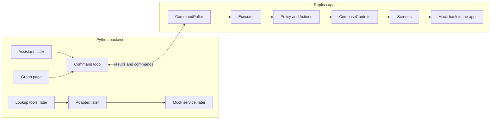

# The bridge

The bridge lets a backend move the app and fill its forms, the way a person would. It can open a
screen, fill a form and show the review page. It can never confirm, submit or pay: those stay a
tap by the user. Inside the app, a small executor takes one command at a time and works the real
screens through their own tap and typing handlers, so the app validates everything as usual. After
each command it reports what the screen now shows.

## The parts

The app always starts the conversation. It polls the backend, so the backend never needs to reach
into the device. The parts marked "later" are not built yet.

To see it work, follow [try it](try-it.md).

## Read the code in this order

All Kotlin files are in `android/app/src/main/java/org/ragbot/replica/bridge/`.

| File | What it does |
|---|---|
| `Contract.kt` | The command, observation and result of `contracts/schemas/`, as Kotlin data |
| `Controls.kt` | The executor's only view of the screen, as an interface |
| `Policy.kt` | Decides what may be touched. This is rule 4 in code |
| `Actions.kt` | The one place the executor taps or types. It asks Policy every time |
| `Routes.kt` | Finds a path over the exported edges of the profile |
| `Navigator.kt` | `navigate` and `select_candidate`: moves one edge at a time and checks each step |
| `FormFiller.kt` | `fill_form` and `show_review`, and the list of review pages |
| `Observer.kt` | Builds the observation and tracks its version and the draft's version |
| `Executor.kt` | Runs one command: rejects bad ones, runs the operation, keeps the journal |
| `ComposeControls.kt` | Reads and drives the real Compose screens |
| `ContractJson.kt` | Reads commands and writes observations and results |
| `BackendClient.kt` | The two HTTP calls the loop makes |
| `CommandPoller.kt` | The pull loop on its own background thread |
| `BridgeConfig.kt` | The debug setting and the device ID |
| `BridgeState.kt` | The current page, as `ReplicaApp` publishes it |

The Python files are in `assistant/`.

| File | What it does |
|---|---|
| `__main__.py` | Starts the server on `127.0.0.1:8100` |
| `app.py` | Puts the routes together |
| `command_queue.py` | One outstanding command per device: delivery, repeats, expiry, stale commands |
| `contract_check.py` | Checks what the app posts against `contracts/schemas/` |
| `mobile_api.py` | The two calls the app makes: resume and post a result |
| `test_harness_api.py` | The development call that queues a `navigate` |
| `graph_data.py` | Reads `app_profiles/` and places every node |
| `graph_page.py` | Serves the page, its data and the live state |
| `static/graph.html` | The page: plain SVG and JavaScript |

The tests show each rule at work:

| Test | Where | Proves |
|---|---|---|
| `PolicyTest` | `android/app/src/test/.../bridge/` | Rule 4, see [safety](safety.md) |
| `ExecutorTest` | same | The command lifecycle |
| `ContractJsonTest`, `CommandPollerTest`, `BridgeConfigTest` | same | The wire format, the loop, rule 3 |
| `BridgeJourneysTest` | `android/app/src/androidTest/.../bridge/` | The demo walk's journeys, on the device |
| `BridgeServicesTest` | same | One journey per service group, on the device |
| `BridgeReachTest` | same | Every screen is reached, or stops for a stated reason |
| `test_command_queue.py` | `tests/backend/` | Delivery, repeats, expiry and stale commands |
| `test_api.py` | `tests/backend/` | The routes, the harness and the graph data |
| `tools/bridge_e2e.py` | run by hand | A click moves the real replica on the emulator |

## More pages

- [One command, end to end](command-lifecycle.md)
- [How rule 4 is enforced](safety.md)
- [What changes for production](production.md)
- [Try it](try-it.md)
