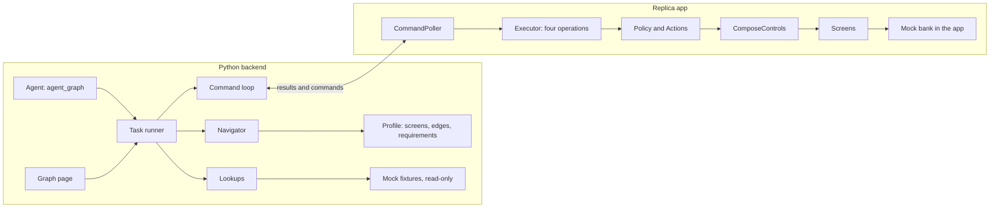

# The bridge

The bridge lets the backend move the app and fill its forms, the way a person would. The thinking
is in Python: a navigator plans the route and lists everything it needs, and a task runner carries
the plan out. The app does four things only: `observe`, `navigate`, `fill_form` and `show_review`.
It can never confirm, submit or pay: those stay a tap by the user. Inside the app, a small executor
takes one command at a time and works the real screens through their own tap and typing handlers,
so the app validates everything as usual. After each command it reports what the screen now shows.

## The parts

The app always starts the conversation. It polls the backend, so the backend never needs to reach
into the device. The agent turns one Persian sentence into a task for the same runner: see
[the agent](agent.md). The graph page's Run plays the user's part without the model.

To see it work, follow [try it](try-it.md). The decision behind this shape is
[D-023](../decisions/0023-python-navigator-thin-bridge.md).

## Read the code in this order

Start in Python, where the decisions are. The files are in `assistant/`.

| File | What it does |
|---|---|
| `navigator.py` | Plans the route over the profile's edges and collects every requirement along it |
| `lookups.py` | Finds records, such as "رضا" to a card. The one read-only adapter a real API replaces |
| `task_runner.py` | Runs a plan: navigate, check, fill, check, then show the review. It never confirms |
| `bridge_link.py` | Sends one command through the queue and waits for its result |
| `command_queue.py` | One outstanding command per device: delivery, repeats, expiry, stale commands |
| `contract_check.py` | Checks what the app posts against `contracts/schemas/` |
| `mobile_api.py` | The two calls the app makes: resume and post a result |
| `test_harness_api.py` | The development call that queues a `navigate` |
| `graph_tasks.py` | What the page asks for: the plan of a click, and the one run |
| `demo_values.py` | Example answers for the Fill with demo values button |
| `graph_data.py` | Reads `app_profiles/` and places every node |
| `graph_page.py` | Serves the page, its data, the live state, the plan and the run |
| `static/graph.html`, `graph_map.js`, `graph_task.js` | The page: layout, the map, and a click's route and run |
| `agent_graph.py`, `agent_nodes.py`, `agent_state.py` | The agent: one LangGraph graph from a sentence to the review ([agent.md](agent.md)) |
| `intent.py`, `slots.py`, `models.py`, `replies.py` | Narrowing and the model's choice, the values and their check, the model clients, the Persian replies |
| `agent_chat.py`, `static/graph_chat.js` | The graph page's chat box |
| `app.py`, `__main__.py` | Put the routes together and start the server on `127.0.0.1:8100` |

The requirements come from the profile, generated from these files in
`android/app/src/main/java/org/ragbot/replica/`:

| File | What it does |
|---|---|
| `ReplicaGraph.kt` | Every screen move and its kind |
| `ProfileForms.kt` | Every form's fields: tag, type, lookup and whether the screen needs it |
| `ProfileWords.kt` | Each field's description and its question in Persian |
| `ProfileSelections.kt` | What each row edge needs chosen before the move |
| `ProfileFeatures.kt` | One feature per journey |
| `ProfileUserOnly.kt` | Every control only the user may touch |

The bridge's Kotlin files are in `android/app/src/main/java/org/ragbot/replica/bridge/`.

| File | What it does |
|---|---|
| `Contract.kt` | The command, observation and result of `contracts/schemas/`, as Kotlin data |
| `Controls.kt` | The executor's only view of the screen, as an interface |
| `Policy.kt` | Decides what may be touched. This is rule 4 in code |
| `Actions.kt` | The one place the executor taps or types. It asks Policy every time |
| `Routes.kt` | How the replica's `navigate` walks the declared edges. An app team may open screens directly instead |
| `Navigator.kt` | `navigate`: moves one edge at a time, applies its arguments, reports where it stopped |
| `FormFiller.kt` | `fill_form` and `show_review`, and the list of review pages |
| `Observer.kt` | Builds the observation and tracks its version and the draft's version |
| `Executor.kt` | Runs one command: rejects bad ones, runs the operation, keeps the journal |
| `ComposeControls.kt` | Reads and drives the real Compose screens |
| `ContractJson.kt` | Reads commands and writes observations and results |
| `BackendClient.kt` | The two HTTP calls the loop makes |
| `CommandPoller.kt` | The pull loop on its own background thread |
| `BridgeConfig.kt` | The debug setting and the device ID |
| `BridgeState.kt` | The current page, as `ReplicaApp` publishes it |

The tests show each rule at work:

| Test | Where | Proves |
|---|---|---|
| `PolicyTest` | `android/app/src/test/.../bridge/` | Rule 4, see [safety](safety.md) |
| `ExecutorTest` | same | The command lifecycle |
| `ContractJsonTest`, `CommandPollerTest`, `BridgeConfigTest` | same | The wire format, the loop, rule 3 |
| `BridgeJourneysTest` | `android/app/src/androidTest/.../bridge/` | The demo walk's journeys, on the device |
| `BridgeServicesTest` | same | One journey per service group, on the device |
| `BridgeReachTest` | same | Every screen is reached, or stops for a stated reason |
| `AssistantPanelTest` | same | With the assistant panel open, the executor still reaches the review behind it; the panel opens from the support menu and minimizes to a bubble ([the panel](panel.md)) |
| `AssistantClientTest` | `android/app/src/test/.../assistant/` | The panel's request body and how it reads the history |
| `test_navigator.py` | `tests/backend/` | Routes, requirements, and refusing a user-only route |
| `test_task_runner.py` | `tests/backend/` | The run, every way it stops, and the four operations only |
| `test_lookups.py` | `tests/backend/` | Name to record, misses and ties, and that it never writes |
| `test_command_queue.py` | `tests/backend/` | Delivery, repeats, expiry and stale commands |
| `test_api.py` | `tests/backend/` | The routes, the harness, the plan and the run |
| `tools/bridge_e2e.py` | run by hand | Card to رضا reaches the review on the emulator; `--features` runs every feature |

## More pages

- [One command, end to end](command-lifecycle.md)
- [How rule 4 is enforced](safety.md)
- [What changes for production](production.md)
- [Try it](try-it.md)
- [How the assistant will pick a feature](intent-selection.md)
- [Every code file, block by block](../code-walkthrough.md)
- [What we ask of the app team](../app-team-handover.md)
