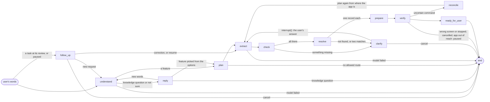

# The agent

The agent turns one Persian sentence, such as «۲۵۰ هزار تومان به رضا کارت به کارت کن», into a
prepared review on the replica, and stops there. Only the user confirms. It is built in #136; the
decision is [D-024](../decisions/0024-agent-loop-first.md).

TEI embeddings narrow the profile's 77 features to the closest 8. The Gemma model on vLLM chooses
one of them and fills the values the route needs. Everything else is code: the navigator plans,
the lookups resolve, the task runner drives the app, and a check confirms the app reached the
review. The agent asks **once** for whatever is missing or ambiguous. There is no RAG yet: a
knowledge question gets a fixed message.

## The graph

One `StateGraph`, built by `build_graph` in `assistant/agent_graph.py`. Its nodes are the methods
of `Nodes` in `assistant/agent_nodes.py`; each takes the state and returns only the keys it
changes.

| Node | What it does | Code it calls | Task state |
|---|---|---|---|
| `understand` | Narrows the features to the closest 8, then lets the model choose one of them, `knowledge_question` or `not_sure`. The schema's `choice` is an enum of exactly those values, and code turns anything else into `not_sure`. | `intent.FeatureIndex.closest`, `intent.choose` | `resolving` for a feature; unchanged (`created`) otherwise |
| `plan` | Plans the chosen feature from the app's current screen, as the graph page does. Each choice gets its allowed keys from [the assistant's words](#the-assistants-own-words-about-the-app). A value the feature decides, or a choice with one key, is set by code and never asked. | `agent_nodes.plan_for` → `Navigator.plan_feature` / `plan`, `words.options`, `words.fixed` | `resolving`, or `failed` with no allowed route |
| `extract` | The model fills the missing requirements. It sees each one's ref, type, Persian `ask` and `description` (or the field's own words), a choice's Persian labels (never its keys), and the user's words. The schema allows exactly those refs, and a choice only one of its labels. A new value replaces one held before. | `slots.extract` | `resolving` |
| `check` | Code only. Drops anything the plan does not ask for. Money: see [what code checks](#what-code-checks-whatever-the-model-says). A choice must be one of its allowed keys or labels. Lists what is still missing. | `slots.checked`, `slots.money`, `slots.choice` | `resolving` |
| `clarify` | `interrupt()` with one Persian message holding every missing `ask`. A missing choice offers its allowed keys, and a missing ref field whose lookup has 2 to 8 records its records (owner, 9 Nov 2026: 8, so the 7 cards fit). Resumes with an option's ref, or with the user's words: then every value is read again, so a correction counts. | `replies.question`, `replies.lookup_options` | `clarifying` |
| `resolve` | Code only. Each named record must match exactly one record of its lookup. A typed card, account or wallet number, or an IBAN that matches no saved one, needs no record. A tie goes back to `clarify` with the matches as options; a miss goes back saying it was not found. | `FixtureLookups.matching`, `lookups.typed` | `resolving` |
| `prepare` | Runs the task runner with the resolved values, the same way the graph page's Run does. | `TaskRunner.run` over the bridge it is given | `preparing` |
| `verify` | Code only. The last observation's screen must be the feature's `review` (or its `destination`, for a feature without a form). Anything else fails with the app's own reason. | the profile | `verifying_review`, or `failed` |
| `ready_for_user` | Says the review is open and the user must check and confirm it, listing every prepared value masked. A feature without a form says the page is open. | `replies.ready` | `ready_for_user`; then `completed` for a feature without a form |
| `reply` | A knowledge question gets «پاسخ به پرسش‌های عمومی در این مرحله فعال نیست». `not_sure` asks with the 8 closest features as options, by their Persian `title`, and «لغو». | `replies` | unchanged, or `cancelled` |
| `follow_up` | A message to a task at its review or paused. A cancel phrase cancels; a paused task resumes; otherwise the model says (an enum) whether the message corrects the prepared task or is a new request. A correction plans again from the app's current screen and reads every value again; a new request starts a new task. | `lifecycle.corrects`, `Lifecycle.again` | `cancelled`; `paused` → `reconciling` → `resolving`; `ready_for_user` → `resolving`; or a new task (`created`) |
| `reconcile` | After an uncertain command: plans again from wherever the app is and prepares once more; a second time fails. | `Lifecycle.again` | `resolving`, or `failed` |

Every question also offers «لغو», and `clarify` and `reply` end the task as `cancelled` when it is
picked or the answer is only a cancel phrase. `verify` reads the runner's stop: `cancelled` →
`cancelling` → `cancelled`; `unreachable` → `paused`; `uncertain` → `reconciling`.

Every change of task state goes through `agent_state.moved`, which follows
`contracts/transitions/task.json` and raises `BadTransition` on anything else. A knowledge
question or a "not sure" creates no task (plan §13), so the state stays `created`. A feature
without a form walks `verifying_review → ready_for_user → completed`, each step checked.

## The state

`AgentState` in `assistant/agent_state.py` holds, for one request: the conversation id, the
user's messages, the offered and chosen intents, the plan (as JSON, with its start screen), the
values, what is missing, the pending note and options, `task_state`, the runner's report and the
reply. Nothing else. `new_request` starts a fresh one for every new message that is not an
answer to a question, so nothing of an earlier request carries over.

The checkpointer is LangGraph's `InMemorySaver`, with `thread_id` = conversation id. A paused
question lives there until the answer comes. A restart forgets it; persistence is P7.

## The models

`assistant/models.py` has two small classes over `httpx`. Both read their address from the
environment (`.env.example` lists them) and raise `ModelError` on any HTTP or JSON failure. The
node then ends the task as `failed` with a plain Persian message and sends nothing.

| Class | Calls | Settings |
|---|---|---|
| `Chat.json(prompt, schema)` | `POST {ASSISTANT_LLM_URL}/chat/completions`, model `ASSISTANT_LLM_MODEL` | temperature 0, 30 s timeout, at most 400 answer tokens, `response_format: json_schema` (strict). One user turn: the server accepts a system role, but the interface takes one prompt. |
| `Embeddings.embed(texts, query=False)` | `GET {ASSISTANT_EMBED_URL}/info` once, then `POST /embed` in batches of the server's `max_client_batch_size` | `normalize: true`. A user's words use the model's `query` prompt (`prompt_name`), as RagBot does; a feature's text has none. |

What the server reported on 9 Nov 2026: vLLM 0.26.0 serving Gemma 4 E4B-it as `/app/model`, with a
4,000-token context (6,144 since 11 Nov 2026). `response_format` with `json_schema` holds the answer to the schema, enums
included (`guided_json` is ignored by this version). TEI 1.9.3 serving
jina-embeddings-v5-text-small-retrieval, 1,024 dimensions, batches of up to 50. The reranker is
not used.

Each feature is embedded once per process as `title + " — " + ` its Persian words from
`app_profiles/assistant_words.json`, with TEI's `document` prompt (the user's words use `query`).

## What the model sees, and what it never sees

It sees the user's words, the offered features (intent, Persian title, Persian words and slot
refs) and, in `extract`, the offered requirements with a choice's Persian labels. It never sees a
screen ID, an edge, an action, a form beyond the offered requirements, the user-only list, a
lookup's records, an app key, or a full card number: every run of 12 or more digits in the user's
words is shown as `****` and its last 4 digits, and code puts the number back wherever the model
copies it (`slots.hidden`, `slots.text`). A test checks the prompts for all of these.

## The assistant's own words about the app

In production the bank's app cannot be changed, so what the assistant must know about it lives in
a file the assistant owns, `app_profiles/assistant_words.json`, read by `assistant/words.py`
([D-026](../decisions/0026-assistant-side-knowledge.md)):

- `features`: Persian words for each of the 77 features, used for the embeddings and the model's
  choice (the profile's descriptions are English, and two pairs of features share a title).
- `choices`: the allowed keys of every choice field and row selection the agent can ask, each with
  a Persian label, either listed or taken from a lookup's records. A key that is screen-specific is
  listed as `"S-164 svc-kind"`.
- `fixed`: values a feature decides itself, such as which paid inquiry the menu opens.
- `fields`: words that tell the model more about a field than its short description.

`tests/backend/test_words.py` checks that every feature has words and every choice the agent can
ask has allowed keys.

## What code checks, whatever the model says

- **Money** is taken from the user's own words (`assistant/amounts.py` reads digits or number
  words, هزار/میلیون/میلیارد and تومان/ریال): the amount in the newest answer wins; otherwise the
  model's amount is used only if the user wrote it; otherwise the one amount the user wrote;
  otherwise the agent asks.
- **A choice** reaches the app only as one of its allowed keys, so no other text is ever sent as a
  key.
- **A record** is matched after making digits Latin, ي/ك Persian, and dropping ZWNJ, «ٔ», generic
  words (کارت، حساب، کیف، شبا…), words no record holds, and spoken endings («تجاریمو»).
- **A typed number** must fit its field: an IBAN field takes only an IBAN, and a bare number is
  never matched inside a saved IBAN.

The model has no tools. It returns JSON, and code acts. The agent reaches the app only through
`TaskRunner`, so the only commands are `navigate`, `fill_form` and `show_review`. No node, prompt
or option can confirm, submit or pay.

## The task's life around the review

Plan §13 and `contracts/transitions/task.json`, done in #142, all on the assistant's side (D-026):

- **Cancel.** The «لغو» option of any question, the chat box's «لغو» button, or a message that is
  only a cancel phrase (لغو، کنسل، بیخیال، منصرف شدم…) cancels the task at a question, at its
  review or while paused. While the task runs, the button stops it before its next command: the
  app stays where it is, and a command already sent is never undone (`lifecycle.StoppableBridge`).
- **A correction after the review.** While the task is `ready_for_user`, a new message in the same
  conversation is a follow-up (`lifecycle.next_input`). The model says whether it corrects the
  prepared task or is a new request; a correction is prepared again from the app's current screen,
  so the old review is replaced by a fresh one.
- **Paused.** If the app cannot be reached (the backend has never seen it), the task pauses with its
  values instead of failing. The next message resumes it from wherever the app is, or cancels it.
- **Reconciling.** If a command's effect is uncertain (no result in time, or an `uncertain`
  outcome), the task plans again from the app's current screen and prepares once more.

## Where it runs

| Where | Bridge | How |
|---|---|---|
| The graph page's chat box | `BridgeLink(queue, DEVICE_ID)` to the replica | `assistant/agent_chat.py`, one conversation per page load, each turn on a background thread. It and the graph page's Run refuse each other (409). Routes: `POST /graph/chat` (exactly one of `text` or `option`), `GET /graph/chat`. |
| `python main_debug.py` | `tools/stand_in_app.py`, on one thread | The same agent with a stand-in for the app. See [debugging](../runbook/debugging.md#6-the-agent-in-one-process-main_debugpy). |
| `python main_debug.py --replica` | `BridgeLink` to the replica, with the backend's own app on a daemon thread | The same agent on the main thread, as the server runs it. |

The stand-in follows the profile: `navigate` walks its edges by breadth-first search, never over
a user-only edge, with each row key in place of `*`; `fill_form` refuses a field the form lacks
or a secret one, and shows a 12+ digit value as `****` and its last 4 digits; `show_review` moves
from a feature's form to its `review`. Every command goes through the real `CommandQueue` and the
real contract checks.

## How well it chooses

Measured on 9 Nov 2026 with 20 Persian sentences over 18 features and 2 knowledge questions,
through `main_debug.py`'s agent with the real models (the sentences are not committed; the frozen
evaluation set is P6-02): the right feature was among the narrowed 8 for 20 of 20, and the model
chose it for 19 of 20. The miss: «قبض برقمو پرداخت کن» chose `wallet_bill` over `bill_payment`;
both are titled «پرداخت قبض». The numbers are in [intent selection](intent-selection.md).

The frozen evaluation set is the measure now: see [the P6-03 report](../reports/p6-03-fixes.md).

## What is not here

No saved-data questions, no persistence (a paused task lives only while the backend runs), no reranker, no RAG and no in-app panel (P6-05). The record-based choice lists
(plates, Sayad cheques, addresses, branches) are written from the mock fixtures; in production they
must come from the bank's lookup APIs.
