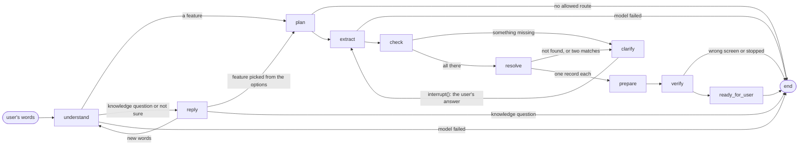

# The agent

The agent turns one Persian sentence, such as «۲۵۰ هزار تومان به رضا کارت به کارت کن», into a
prepared review on the replica, and stops there. Only the user confirms. It is built in #136; the
decision is [D-024](../decisions/0024-agent-loop-first.md).

TEI embeddings narrow the profile's 77 features to the closest 8. The Gemma model on vLLM chooses
one of them and fills the values the route needs. Everything else is code: the navigator plans,
the lookups resolve, the task runner drives the app, and a check confirms the app reached the
review. The agent asks **once** for whatever is missing or ambiguous. There is no RAG yet: a
knowledge question gets a fixed message.

## The graph

One `StateGraph`, built by `build_graph` in `assistant/agent_graph.py`. Its nodes are the methods
of `Nodes` in `assistant/agent_nodes.py`; each takes the state and returns only the keys it
changes.

| Node | What it does | Code it calls | Task state |
|---|---|---|---|
| `understand` | Narrows the features to the closest 8, then lets the model choose one of them, `knowledge_question` or `not_sure`. The schema's `choice` is an enum of exactly those values, and code turns anything else into `not_sure`. | `intent.FeatureIndex.closest`, `intent.choose` | `resolving` for a feature; unchanged (`created`) otherwise |
| `plan` | Plans the chosen feature from the app's current screen, as the graph page does. | `agent_nodes.plan_for` → `Navigator.plan_feature` / `plan` | `resolving`, or `failed` with no allowed route |
| `extract` | The model fills the missing requirements only. It sees each one's ref, type, Persian `ask` and `description`, and the user's words. The schema allows exactly those refs. | `slots.extract` | `resolving` |
| `check` | Code only. Drops anything the plan does not ask for. Money must be a whole number with `IRR` or `IRT`; toman becomes rials ×10 as a Python `int`. Lists what is still missing. | `slots.checked`, `slots.money` → `task_runner.money_value` | `resolving` |
| `clarify` | `interrupt()` with one Persian message holding every missing `ask`. A missing ref field whose lookup has 2 to 8 records also gets its records as options (owner, 9 Nov 2026: 8, so the 7 cards fit). Resumes with the user's text or an option's ref. | `replies.question`, `replies.lookup_options` → `FixtureLookups.candidates` | `clarifying` |
| `resolve` | Code only. Each named record must match exactly one record of its lookup. A tie goes back to `clarify` with the matches as options; a miss goes back saying it was not found. | `FixtureLookups.matching` | `resolving` |
| `prepare` | Runs the task runner with the resolved values, the same way the graph page's Run does. | `TaskRunner.run` over the bridge it is given | `preparing` |
| `verify` | Code only. The last observation's screen must be the feature's `review` (or its `destination`, for a feature without a form). Anything else fails with the app's own reason. | the profile | `verifying_review`, or `failed` |
| `ready_for_user` | Says the review is open and the user must check and confirm it, listing every prepared value masked. A feature without a form says the page is open. | `replies.ready` | `ready_for_user`; then `completed` for a feature without a form |
| `reply` | A knowledge question gets «پاسخ به پرسش‌های عمومی در این مرحله فعال نیست». `not_sure` asks with the 8 closest features as options, by their Persian `title`. | `replies` | unchanged |

Every change of task state goes through `agent_state.moved`, which follows
`contracts/transitions/task.json` and raises `BadTransition` on anything else. A knowledge
question or a "not sure" creates no task (plan §13), so the state stays `created`. A feature
without a form walks `verifying_review → ready_for_user → completed`, each step checked.

## The state

`AgentState` in `assistant/agent_state.py` holds, for one request: the conversation id, the
user's messages, the offered and chosen intents, the plan (as JSON, with its start screen), the
values, what is missing, the pending note and options, `task_state`, the runner's report and the
reply. Nothing else. `new_request` starts a fresh one for every new message that is not an
answer to a question, so nothing of an earlier request carries over.

The checkpointer is LangGraph's `InMemorySaver`, with `thread_id` = conversation id. A paused
question lives there until the answer comes. A restart forgets it; persistence is P7.

## The models

`assistant/models.py` has two small classes over `httpx`. Both read their address from the
environment (`.env.example` lists them) and raise `ModelError` on any HTTP or JSON failure. The
node then ends the task as `failed` with a plain Persian message and sends nothing.

| Class | Calls | Settings |
|---|---|---|
| `Chat.json(prompt, schema)` | `POST {ASSISTANT_LLM_URL}/chat/completions`, model `ASSISTANT_LLM_MODEL` | temperature 0, 30 s timeout, at most 400 answer tokens, `response_format: json_schema` (strict). One user turn: the server accepts a system role, but the interface takes one prompt. |
| `Embeddings.embed(texts, query=False)` | `GET {ASSISTANT_EMBED_URL}/info` once, then `POST /embed` in batches of the server's `max_client_batch_size` | `normalize: true`. A user's words use the model's `query` prompt (`prompt_name`), as RagBot does; a feature's text has none. |

What the server reported on 9 Nov 2026: vLLM 0.26.0 serving Gemma 4 E4B-it as `/app/model`, with a
4,000-token context. `response_format` with `json_schema` holds the answer to the schema, enums
included (`guided_json` is ignored by this version). TEI 1.9.3 serving
jina-embeddings-v5-text-small-retrieval, 1,024 dimensions, batches of up to 50. The reranker is
not used.

Each feature is embedded once per process as `title + " — " + description`.

## What the model sees, and what it never sees

It sees the user's words, the offered features (intent, Persian title, description and slot refs)
and, in `extract`, the offered requirements. It never sees a screen ID, an edge, an action, a form
beyond the offered requirements, the user-only list, a lookup's records, or a full card number:
every run of 12 or more digits in the user's words becomes `[number N]` before the prompt, and
code puts the number back afterwards (`slots.hidden`, `slots.text`). A test checks the prompts for all of these.

The model has no tools. It returns JSON, and code acts. The agent reaches the app only through
`TaskRunner`, so the only commands are `navigate`, `fill_form` and `show_review`. No node, prompt
or option can confirm, submit or pay.

## Where it runs

| Where | Bridge | How |
|---|---|---|
| The graph page's chat box | `BridgeLink(queue, DEVICE_ID)` to the replica | `assistant/agent_chat.py`, one conversation per page load, each turn on a background thread. It and the graph page's Run refuse each other (409). Routes: `POST /graph/chat` (exactly one of `text` or `option`), `GET /graph/chat`. |
| `python main_debug.py` | `tools/stand_in_app.py`, on one thread | The same agent with a stand-in for the app. See [debugging](../runbook/debugging.md#6-the-agent-in-one-process-main_debugpy). |
| `python main_debug.py --replica` | `BridgeLink` to the replica, with the backend's own app on a daemon thread | The same agent on the main thread, as the server runs it. |

The stand-in follows the profile: `navigate` walks its edges by breadth-first search, never over
a user-only edge, with each row key in place of `*`; `fill_form` refuses a field the form lacks
or a secret one, and shows a 12+ digit value as `****` and its last 4 digits; `show_review` moves
from a feature's form to its `review`. Every command goes through the real `CommandQueue` and the
real contract checks.

## How well it chooses

Measured on 9 Nov 2026 with 20 Persian sentences over 18 features and 2 knowledge questions,
through `main_debug.py`'s agent with the real models (the sentences are not committed; the frozen
evaluation set is P6-02): the right feature was among the narrowed 8 for 20 of 20, and the model
chose it for 19 of 20. The miss: «قبض برقمو پرداخت کن» chose `wallet_bill` over `bill_payment`;
both are titled «پرداخت قبض». The numbers are in [intent selection](intent-selection.md).

## What is not here

No cancel or correction flow (a new message after the review is a new request), no saved-data
questions, no persistence, no reranker, no RAG and no in-app panel (P6-05). Choice fields carry no
list of allowed keys in the profile, so the model can only copy the user's words for them, and
the app refuses a key it does not have.
