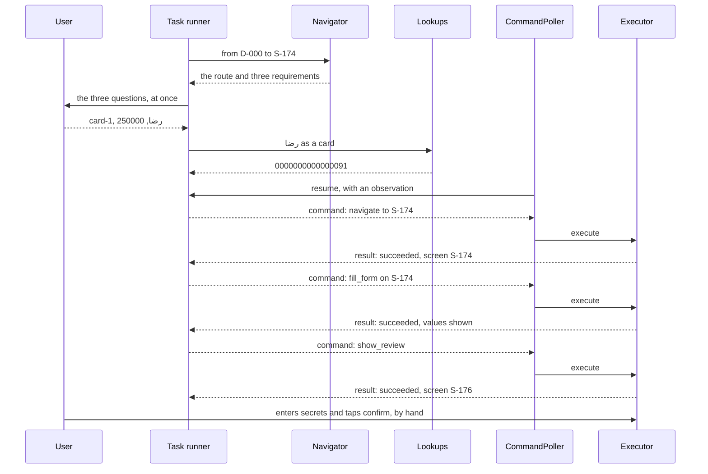

# One task, end to end

This page follows "card to card to رضا, 250000 IRR". The plan, commands and observations below come
from a real run on the emulator, shortened where marked.

First the backend plans and asks. Only then does anything move. The task takes three commands,
`navigate`, `fill_form` and `show_review`, and then it stops. The user reads the review page, enters
the card secrets and taps confirm.



## Step 1: the navigator's plan

`Navigator.plan_feature` runs a plain breadth-first search over the profile's edges, from the
replica's screen to the feature's target. Then it collects what the route needs: each screen's
required fields, and each edge's selections. Secret fields are never listed. This route has no
selection, and `S-174` has three required fields.

```json
{
  "target": "S-174",
  "route": [
    { "from": "D-000", "to": "S-026", "action": "demo-entry" },
    { "from": "S-026", "to": "S-174", "action": "menu-card-transfer" }
  ],
  "requirements": [
    {
      "screen": "S-174", "ref": "card-transfer-source", "kind": "field", "type": "ref",
      "ask": "از کدام کارت انتقال انجام شود؟", "description": "کارت مبدا", "lookup": "cards"
    },
    {
      "screen": "S-174", "ref": "card-transfer-destination", "kind": "field", "type": "ref",
      "ask": "به چه کسی یا کدام کارت منتقل شود؟", "description": "کارت مقصد", "lookup": "contacts.card"
    },
    {
      "screen": "S-174", "ref": "card-transfer-amount", "kind": "field", "type": "money",
      "ask": "چند ریال منتقل شود؟", "description": "مبلغ انتقال", "lookup": null
    }
  ]
}
```

A destination behind a row, such as `S-284`, would also list a selection: `charity`, with its own
question, kind `selection` and lookup `charities`.

## Step 2: the questions and the lookups

The user gets all three questions together. The graph page shows them with their inputs, and the
assistant will ask them in one message later. `TaskRunner.prepared` then turns the answers into what
the app takes, before the app moves:

- `card-1` is the key of a card in the `cards` lookup.
- `رضا` goes through `contacts.card`, and becomes `0000000000000091`.
- `250000` becomes `{ "value": 250000, "unit": "IRR" }`.

If a value is missing, a contact is unknown, two contacts match, or an amount is not a whole number,
the run stops here with a reason, and the app has not moved.

## Step 3: navigate

The runner sends the screen and the observation version it last saw. Any selections would travel in
an `arguments` object next to `destination`. This command has none.

```json
{
  "protocol_version": 1,
  "profile_version": 1,
  "task_id": "graph-…",
  "task_revision": 1,
  "command_id": "…",
  "device_id": "replica-dev",
  "session_id": "replica-dev",
  "operation": "navigate",
  "arguments": { "destination": "S-174" },
  "expected_observation_version": 1,
  "expires_at": "2026-11-07T12:00:30Z"
}
```

The executor first checks the command (see [Every way it can stop](#every-way-it-can-stop)). How the
app reaches the screen is its own business. The replica walks the declared edges, tapping each tag
through its own click handler and waiting for the new screen. The runner checks that
`observation.screen` is `S-174`.

```json
{
  "command_id": "…",
  "outcome": "succeeded",
  "postcondition": "screen_is_S-174",
  "observation": {
    "observation_version": 2,
    "app_version": 1,
    "profile_version": 1,
    "screen": "S-174",
    "modal": null,
    "loading": false,
    "fields": [
      { "ref": "card-transfer-source", "value": "انتخاب کارت" },
      { "ref": "card-transfer-destination", "value": "" },
      { "ref": "card-transfer-amount", "value": "" }
    ],
    "draft": null,
    "supported_operations": ["observe", "navigate", "fill_form", "show_review"]
  },
  "draft_version": 0,
  "trace": [
    { "from": "D-000", "to": "S-026", "action": "demo-entry" },
    { "from": "S-026", "to": "S-174", "action": "menu-card-transfer" }
  ]
}
```

## Step 4: fill_form

One generic command fills every form, driven by field tags. Money is a whole number with its unit.

```json
{
  "operation": "fill_form",
  "arguments": {
    "form": "S-174",
    "values": {
      "card-transfer-source": "card-1",
      "card-transfer-destination": "0000000000000091",
      "card-transfer-amount": { "value": 250000, "unit": "IRR" }
    }
  },
  "expected_observation_version": 2,
  "expected_draft_version": 0
}
```

`FormFiller` treats each field by what the screen shows:

- `card-transfer-source` is a picker. It taps the picker, then the option `card-transfer-source-card-1`.
- The other two are text fields. It sets each through the field's own change handler, then reads
  the value back.

This is the same state a user types into, so the form's own rules apply. The result reports a new
draft, and card numbers come back masked. The runner compares each field with what it sent, and
stops if one disagrees: a masked number by its last four digits, and an amount by its digits.

```json
{
  "command_id": "…",
  "outcome": "succeeded",
  "postcondition": "form_filled_S-174",
  "observation": {
    "observation_version": 3,
    "screen": "S-174",
    "fields": [
      { "ref": "card-transfer-source", "value": "****0018" },
      { "ref": "card-transfer-destination", "value": "****0091" },
      { "ref": "card-transfer-amount", "value": "250000" }
    ],
    "draft": { "draft_id": "draft-1", "draft_version": 1, "review_version": 0 }
  },
  "draft_version": 1
}
```

(The observation is shortened here.)

## Step 5: show_review

```json
{
  "operation": "show_review",
  "arguments": {},
  "expected_observation_version": 3,
  "expected_draft_version": 1
}
```

`FormFiller` taps `card-transfer-review`, the form's own Continue button. The form validates, then
opens the review. On that page the executor stops, and no command can go further.

```json
{
  "command_id": "…",
  "outcome": "succeeded",
  "postcondition": "review_shown_S-176",
  "observation": {
    "observation_version": 4,
    "screen": "S-176",
    "fields": [{ "ref": "card-transfer-note", "value": "" }],
    "draft": { "draft_id": "draft-1", "draft_version": 1, "review_version": 1 }
  },
  "draft_version": 1
}
```

`review_version` now equals `draft_version`: the review shows exactly the draft that was filled.
The CVV2, expiry and password fields on this page never appear in an observation. This is the one
moment the user verifies, and only the user confirms.

## Every way it can stop

**Rejected before anything is touched:**

| Outcome | `error_code` | When |
|---|---|---|
| `rejected_stale` | `stale_observation` | The screen changed since the backend last looked |
| `rejected_stale` | `stale_draft` | The draft changed, for example the user edited a field |
| `rejected_expired` | `expired` | `expires_at` has passed |
| `rejected_policy` | `wrong_device`, `wrong_protocol`, `wrong_profile` | The command is not for this app |
| `rejected_policy` | `unknown_operation`, `unknown_screen` | Not one of the four operations, or not a profile screen |
| `rejected_policy` | `field_not_fillable` | A secret, consent or unknown field |
| `rejected_policy` | `unknown_argument`, `invalid_argument` | An argument no edge declares, or a key that is not one plain word |

A repeated `command_id` runs nothing. The journal returns the first result.

**Blocked: the app is fine, but something else is needed.** The `needs` list says what:

| `needs` | Meaning |
|---|---|
| `no_executor_route` | Only a user step reaches this screen, such as a receipt. Nothing was tapped |
| `missing_argument` | The next step opens a row, and `navigate` has no key for it. The navigator would have listed it |
| Field refs, such as `bill-id` | The form's own validation refused. These fields show an error. The observation schema has no error field, so the result reports them beside the fresh observation |
| `valid_form` | The page stayed where it was, but no field shows an error |
| `control_disabled:<tag>` | The control is disabled, so it was not fired. Something on the page must be chosen first |
| `control_not_shown:<tag>` | The control is not on the page |
| `unexpected_screen` | The app landed on a page with no way on, such as a form that chose another page |
| `close_dialog` | A dialog is open, and the user must close it |
| `navigate` | `fill_form` was sent for a form that is not on screen |
| `no_review_here` | This screen has no review step. The runner reports the task as arrived |

**Failed or uncertain:**

| Outcome | `error_code` | Meaning |
|---|---|---|
| `failed` | `field_not_set` | The field did not take the value, so read-back differed |
| `failed` | `policy_refused` | The last gate refused a tap. This should not happen; it is a bug in the route or the fill |
| `failed` | `route_too_long` | More than 40 steps without arriving |
| `failed` | `invalid_value`, `control_not_clickable` | A bad choice key, or a control with no click handler |
| `uncertain` | `executor_error` | The app did not answer. Only a fresh observation can tell what happened |

**Stopped by the task runner:** it stops with a plain reason, and shows the last observation, when a
`navigate` does not arrive, a `fill_form` is refused, a page shows a different value from the one
sent, or the review does not open. A `stale_observation` is the one thing it repeats, up to three
times, because the contract says the command did not run. A `stale_draft` means the user changed
something, so it stops.

**What the agent does with a stop (#142):** three stops are not failures. An `uncertain` outcome, or
no result in time, means the step may have run: the task goes `reconciling`, plans again from the
app's current screen and prepares once more; a second uncertain step fails it. A device the backend
has never seen means the app is out of reach: the task goes `paused` and keeps its values until the
user writes again («ادامه»). A user's cancel stops the run before its next command; a command
already sent is never undone. See [the agent](agent.md#the-tasks-life-around-the-review).

Commands follow `contracts/transitions/command.json`.
