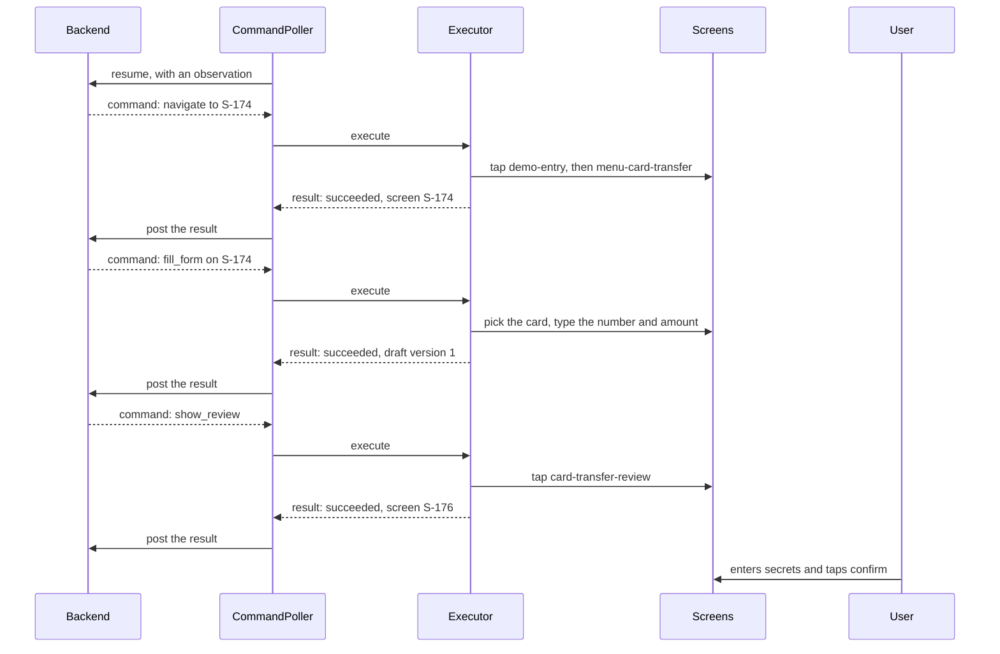

# One command, end to end

This page follows "card to card to رضا, 250000 IRR". The JSON below was captured from a real run
of `BridgeJourneysTest.cardToCardToReza`, shortened where marked.

The task takes three commands: `navigate`, `fill_form` and `show_review`. It then stops. The user
reads the review page, enters the card secrets and taps confirm.



## Step 1: navigate

The backend sends the screen ID and the observation version it last saw.

```json
{
  "protocol_version": 1,
  "profile_version": 1,
  "task_id": "task-1",
  "task_revision": 1,
  "command_id": "cmd-1",
  "device_id": "replica-dev",
  "session_id": "replica-dev",
  "operation": "navigate",
  "arguments": { "destination": "S-174" },
  "expected_observation_version": 1,
  "expires_at": "2100-01-01T00:00:00Z"
}
```

The executor first checks the command (see [Every way it can stop](#every-way-it-can-stop)). Then
`Navigator` finds a route over the profile's edges. The app is on its demo front page, `D-000`, so
the route has two edges. For each edge it taps the listed tags through their own click handlers,
then waits for the new screen.

```json
{
  "command_id": "cmd-1",
  "outcome": "succeeded",
  "postcondition": "screen_is_S-174",
  "observation": {
    "observation_version": 2,
    "app_version": 1,
    "profile_version": 1,
    "screen": "S-174",
    "modal": null,
    "loading": false,
    "fields": [
      { "ref": "card-transfer-source", "value": "انتخاب کارت" },
      { "ref": "card-transfer-destination", "value": "" },
      { "ref": "card-transfer-amount", "value": "" }
    ],
    "draft": null,
    "supported_operations": ["observe", "navigate", "fill_form", "select_candidate", "show_review"]
  },
  "draft_version": 0,
  "trace": [
    { "from": "D-000", "to": "S-026", "action": "demo-entry" },
    { "from": "S-026", "to": "S-174", "action": "menu-card-transfer" }
  ]
}
```

## Step 2: fill_form

Later, a lookup tool will turn "رضا" into a card number. For now the command carries it directly.
Money is a whole number with its unit.

```json
{
  "operation": "fill_form",
  "arguments": {
    "form": "S-174",
    "values": {
      "card-transfer-source": "card-1",
      "card-transfer-destination": "0000000000000091",
      "card-transfer-amount": { "value": 250000, "unit": "IRR" }
    }
  },
  "expected_observation_version": 2,
  "expected_draft_version": 0
}
```

`FormFiller` treats each field by what the screen shows:

- `card-transfer-source` is a picker. It taps the picker, then the option `card-transfer-source-card-1`.
- The other two are text fields. It sets each through the field's own change handler, then reads
  the value back.

This is the same state a user types into, so the form's own rules apply. The result reports a new
draft, and card numbers come back masked.

```json
{
  "command_id": "cmd-2",
  "outcome": "succeeded",
  "postcondition": "form_filled_S-174",
  "observation": {
    "observation_version": 3,
    "screen": "S-174",
    "fields": [
      { "ref": "card-transfer-source", "value": "****0018" },
      { "ref": "card-transfer-destination", "value": "****0091" },
      { "ref": "card-transfer-amount", "value": "250000" }
    ],
    "draft": { "draft_id": "draft-1", "draft_version": 1, "review_version": 0 }
  },
  "draft_version": 1
}
```

(The observation is shortened here.)

## Step 3: show_review

```json
{
  "operation": "show_review",
  "arguments": {},
  "expected_observation_version": 3,
  "expected_draft_version": 1
}
```

`FormFiller` taps `card-transfer-review`, the form's own Continue button. The form validates, then
opens the review. On that page the executor stops, and no command can go further.

```json
{
  "command_id": "cmd-3",
  "outcome": "succeeded",
  "postcondition": "review_shown_S-176",
  "observation": {
    "observation_version": 4,
    "screen": "S-176",
    "fields": [{ "ref": "card-transfer-note", "value": "" }],
    "draft": { "draft_id": "draft-1", "draft_version": 1, "review_version": 1 }
  },
  "draft_version": 1
}
```

`review_version` now equals `draft_version`: the review shows exactly the draft that was filled.
The CVV2, expiry and password fields on this page never appear in an observation.

## Every way it can stop

**Rejected before anything is touched:**

| Outcome | `error_code` | When |
|---|---|---|
| `rejected_stale` | `stale_observation` | The screen changed since the backend last looked |
| `rejected_stale` | `stale_draft` | The draft changed, for example the user edited a field |
| `rejected_expired` | `expired` | `expires_at` has passed |
| `rejected_policy` | `wrong_device`, `wrong_protocol`, `wrong_profile` | The command is not for this app |
| `rejected_policy` | `unknown_operation`, `unknown_screen` | Not one of the five operations, or not a profile screen |
| `rejected_policy` | `field_not_fillable` | A secret, consent or unknown field |
| `rejected_policy` | `invalid_candidate` | The ref is not one plain word |

A repeated `command_id` runs nothing. The journal returns the first result.

**Blocked: the app is fine, but something else is needed.** The `needs` list says what:

| `needs` | Meaning |
|---|---|
| `no_executor_route` | Only a user step reaches this screen, such as a receipt. Nothing was tapped |
| `select_candidate` | The next step opens a row. Send `select_candidate` with the row's key |
| `candidate_not_shown` | No row has that key |
| Field refs, such as `bill-id` | The form's own validation refused. These fields show an error |
| `valid_form` | The page stayed where it was, but no field shows an error |
| `control_disabled:<tag>` | The control is disabled, so it was not fired. Something on the page must be chosen first |
| `control_not_shown:<tag>` | The control is not on the page |
| `form_chose_another_page` | The form's values led to a different page than the route expected |
| `close_dialog` | A dialog is open, and the user must close it |
| `navigate` | `fill_form` was sent for a form that is not on screen |
| `no_review_here` | This screen has no review step |

**Failed or uncertain:**

| Outcome | `error_code` | Meaning |
|---|---|---|
| `failed` | `field_not_set` | The field did not take the value, so read-back differed |
| `failed` | `policy_refused` | The last gate refused a tap. This should not happen; it is a bug in the route or the fill |
| `failed` | `route_too_long` | More than 40 steps without arriving |
| `failed` | `invalid_value`, `control_not_clickable` | A bad choice key, or a control with no click handler |
| `uncertain` | `executor_error` | The app did not answer. Only a fresh observation can tell what happened |

Commands follow `contracts/transitions/command.json`.
