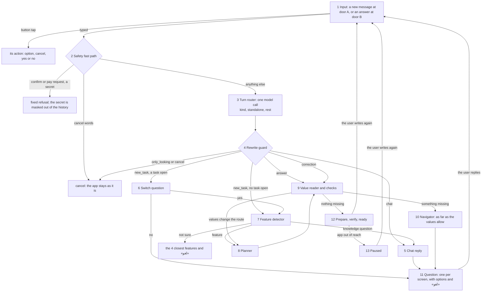

# The conversation flow

Every message the user writes is understood in the context of the conversation and the open task:
an answer, a correction, a new task, small talk, a cancel, or "only looking". The decision is
[D-034](../decisions/0034-conversation-flow.md) (issue #185). It applies to the
[workflow agent](agent.md), the default. The [ReAct agent](react-agent.md) can reuse the router
later.

This page is the design. CF-1 (#186) built the tests first, CF-2 (#187) built nodes 1 to 4, 6 and
13, and CF-3 (#188) builds node 5. Nodes 7 to 12 are reused.

## What CF-2 built, and where it differs from the design

**Where the code is:**
- `assistant/conversation.py`: the history lines, the router (prompt, schema and fallback), the
  rewrite guard and the open task's summary.
- `assistant/lifecycle.py`: `fast()`, the fast path, and `next_input()`, which carries the history
  over and gives the message as the turn's `said`.
- `assistant/agent_lifecycle.py`: `route` (door A) and `switch`.
- `assistant/agent_nodes.py`: door B inside `clarify` and `reply`, the 4 not-sure options and the
  second-task note.

The ReAct agent is unchanged; it still uses its own follow-up.

**Changes found on the tuning sets:**

| Change | Why |
|---|---|
| A rewrite is used only once the conversation has earlier user words; a first message is used as the user wrote it | A rewrite of a first message can only change it: it lost an amount and a card (tuning T-002, T-003). Later, the rewrite is what makes «همونو» and «نه ولش، قبض آبمو بده» clear for the chooser (CH-001 picked the loans page from the raw words). |
| A correction after the review reads the newest message on its own, plus the workflow's `named` check on it, and keeps every other value | Re-reading every message let the model bring the old value back. «از کوتاه‌مدت بخر» and «به حساب نگار صادقی بزن» prepared the old review again, which was a critical wrong action already in the baseline. |
| When the router says cancel, the chooser also reads the message; if it names a feature, it is a new task | Gemma read «ولش، کارت به کارت میخوام» and «نه اصلا برو خونه» as a cancel. A plain cancel («بیخیالش شو») names no feature and still cancels. |
| The router prompt says the app's domain, and that with no task open a request (even a vague one) is a new task | Out-of-app requests and vague requests were misread. |
| With no task open, chat stands only when the chooser finds no feature in the message; else it is a new task | A request worded as a question («ببین ماشین … چند بار رفته تو طرح آلودگی هوا», held-out H-045) read as chat to the router. With no task open, the chooser decides what is a request, as before CF-2, at one more model call for a first message the router calls chat. Found on held-out. |
| A secret word must start a word | «رمز» inside «کارمزد» (a fee) with a card's digits read as a typed secret, and three held-out requests with a fee were refused (H-032, H-049, H-050). Found on held-out. |
| The guard checks people's and accounts' names only (contacts by card, account, IBAN or wallet, and the user's accounts), and a record's word is allowed beside another word of the same label the user said | «سپرده» in a rewrite of «پس‌انداز» is the user's own account, and «خرید» from a saved loan's title is no name; an invented «نگار صادقی» is still refused. |
| The router is told to copy the amount, card, account, number and person of the request «همین / همون / عین همین» refers to, as the user wrote them | Rewrites of references kept the words but left the values out, or copied the assistant's masked labels. |
| The guard restores a ****1234 as the user's full number, or as the 4 digits the user typed, and drops one the user never typed | A rewrite that copied the review's «****8880» was thrown away, and the chooser read «یکی دیگه هم عین همین بزن» as "repeat transaction" (CH-023, a critical page). |
| A new task the chooser is not sure of still gets the switch question, naming «کار تازه»; after «بله» it is understood again and its options asked | «نه ولش، قبض آبمو بده» rewritten as «قبض آبم رو بده» was not sure, and got the fixed reply instead of the switch. |
| Chat gets `replies.KNOWLEDGE` until CF-3 | As planned. |

The router's decisions print in the step trace (`ASSISTANT_TRACE=1`, step `router`).

## What is wrong today

The workflow checks what the user wants only at fixed points:
- the first message;
- after the review (`lifecycle.corrects`: a correction or a new request);
- the not-sure question;
- a pause;
- the fixed cancel and "only looking" words.

At a question, every other message is read as an answer. So these go wrong:

| Message | What happens today |
|---|---|
| «نه ولش، قبض برقو بده» while a card transfer asks for the source | Nothing is filled, and the same question is asked again |
| «سلام» or «مرسی» in the middle of a task | Read as an answer |
| «همونو برای سارا هم بزن» after a review | Not understood: nothing of the earlier request is kept |
| «کارت به کارت کن، بعد قبض بده» | One task is done; the other is dropped without a word |
| «تأیید کن» or a typed PIN | Read as an answer; the PIN reaches the model |

## The two doors

A question waits inside a graph node: LangGraph's `interrupt()` in `clarify`, `reply` (not sure)
and the new switch question. The user's answer resumes that node. So the router is one function,
used at two doors:

- **Door A: a new message starts a turn.** No question is waiting: a new request, or a message to
  a task at its review or paused. The graph starts at its `route` node.
- **Door B: an answer resumes a waiting node.** The waiting node calls the same router on the
  answer right after `interrupt()` returns. An answer goes on as today. Any other kind leaves the
  node with that kind, and the graph's edges send it where door A would.

Both doors see the same picture and take the same decisions. The chat box, the panel, `main_debug.py`
and the evaluator keep their interface: an `__interrupt__` with a question, or a reply.



## The nodes

Each node is either code or one model call. Each model call's answer is held to a JSON schema,
and code still checks it.

### 1. Input

- **Kind:** code.
- **Input:** a button's ref, or typed text.
- **What it does:** a button tap acts at once, with no model: an option's ref, «لغو», or the switch
  question's «بله» or «نه». Typed text goes on to node 2.

### 2. Safety fast path

- **Kind:** code, in `lifecycle.py`.
- **Runs:** before any model, so it works when the model is down.
- **Rules:**

| Message | What happens |
|---|---|
| A whole message from today's cancel words | The task is cancelled and the app stays where it is (`CANCELLED_OPEN` after the app has moved) |
| Today's "only looking" phrases | The task stops and the page stays open |
| A whole message asking to confirm or submit: «تأیید کن», «تاییدش کن», «بزن بره», «پرداختش کن», «انجامش بده», «ثبت کن», «نهایی کن», «ارسال کن» | `CONFIRM_BY_TOUCH`: «تأیید فقط با لمس دکمه در صفحه بازبینی انجام می‌شود؛ من فقط آماده می‌کنم.» At a question, the question follows it |
| A secret word («رمز», «رمز دوم», «رمز پویا», «پین», «pin», «cvv», «سی وی وی», «کد تایید», «کد یکبار مصرف», «otp») with a run of 3 to 8 digits | `NO_SECRETS`: «رمز یا کد را هرگز اینجا ننویسید؛ آن را فقط خودتان در صفحه برنامه وارد کنید.» The message is kept in the history only as «[حذف شد]», so no prompt, log or report ever has it |

- **Not a confirm request:** a whole-message confirm phrase is a refusal, but «قبضمو پرداخت کن» is a
  request and goes to the router.

### 3. Turn router (with query rewriting)

- **Kind:** one model call, at temperature 0, in the new `assistant/conversation.py`.
- **Sees:**
  - the last 4 turns (up to 8 lines, user and assistant), masked, each cut to 200 characters;
  - the open task: its feature's title, the values held as masked labels, and what is missing;
  - the pending question and its option labels;
  - the newest message, masked.
- **It never sees:** an app key, a screen ID, a full number or a secret.
- **Schema:** `{"kind": enum, "standalone": string|null, "rest": string|null}`.

| kind | Meaning |
|---|---|
| `answer` | It answers the pending question, or gives values for the open task |
| `correction` | It changes a value the open task already holds |
| `new_task` | It asks to do or see something in the app |
| `chat` | A greeting, thanks, small talk, a question, a request the app cannot do, rude words |
| `only_looking` | The user wanted only to see the page |
| `cancel` | Stop the open task (cancel words the fast path did not list) |

**Prompt:**

```text
You read the newest message in the chat of a Persian banking app's assistant and say what it is.
The assistant prepares tasks in the app up to a review page; only the user confirms, by touch.

Recent conversation, oldest first:
- user: «…»
- assistant: «…»
Open task: «کارت به کارت». Held: کارت مقصد «رضا محمدی ****8880», مبلغ «5,000,000 ریال». Missing: کارت مبدا.
Pending question: «از کدام کارت انتقال انجام شود؟» Options: ****3566 | ****4544 | لغو
Newest message: «…»

kind:
- answer: it answers the pending question, or gives values for the open task.
- correction: it changes a value the open task already holds («نه، ۳۰۰ هزار بشه», «از اون یکی کارتم»).
- new_task: it asks to do or see something in the app («قبض برقمو بده», «برو به خانه»), even while a task is open.
- chat: a greeting, thanks, small talk, a question, a request the app cannot do, or rude words.
- only_looking: the user only wanted to see the page and wants nothing done («فقط میخواستم ببینم»).
- cancel: the user wants to stop the open task («ولش کن»، «نمیخوام دیگه»).
standalone: only for new_task. The request as one full Persian sentence in the user's own words,
filling in what it refers to from the conversation («همونو برای سارا هم بزن» → «۵۰۰ هزار تومان
به سارا کارت به کارت کن»). Never add an amount, name or number the conversation does not have.
rest: if the message asks for a second task too, that task as one sentence; else null.
```

With no task open, the prompt says «Open task: none.» and «Pending question: none.». The words of
each kind are tuned on CF-1's tuning set only.

**What code does with the kind:**

| Situation | Router's answer | What code does |
|---|---|---|
| No task is open | `answer` or `correction` | Taken as `new_task`, with the message as `standalone`. «۵۰۰ هزار به رضا» as a first message is a request |
| No task is open | `cancel` or `only_looking` | A short fixed line, `NOTHING_OPEN`: «کاری در جریان نیست؛ بنویسید چه کاری انجام دهم.» |
| Paused | not `cancel`, not `new_task` | The task resumes, as today |
| The not-sure question | `answer` or `new_task` | Understood again on the new words |
| The switch question | `answer` (typed «آره», «نه») | Read with a fixed yes/no list; anything else asks it again |

**Fallback:** if the model fails, a message at a question is read as an answer (today's behaviour),
and any other message is a `new_task` with itself as `standalone`. The fallback is recorded in the
step.

### 4. Rewrite guard

- **Kind:** code.
- **Why:** `standalone` feeds only the feature detector and the new task's first message. Values
  still come from the user's own words, as `slots.money` and the record checks require.
- **It accepts `standalone` only when all of these hold:**
  - every amount in it (read by `amounts.amounts`) equals an amount the user wrote in the
    conversation;
  - every run of 4 or more digits, or `****1234`, is in the user's messages;
  - every word of it that is a word of a contact's or record's label (from the lookups) is in the
    user's messages.
- **Otherwise** `standalone` is the user's own newest message, unchanged. A rewrite can drop a
  reference, but it can never invent a value.
- **`rest`** gets the same check.

### 5. Chat reply

- **Kind:** one model call (CF-3). Until then, `replies.KNOWLEDGE`.
- **Sees:** the last 4 turns, the newest message, and whether a task is open.
- **Schema:** `{"reply": string}`, at most 300 characters.

**Prompt:**

```text
You are the friendly assistant of a Persian mobile banking app. Reply to the user's newest message
in one or two short, warm Persian sentences.
What you can do: prepare tasks in this app (transfers, bill payments, top-ups, loan installments,
cards, cheques and more) up to a review page that only the user confirms, by touch.
- A greeting or thanks: answer it warmly and offer help.
- Something the app cannot do: say kindly that you cannot do it here, and say what you can do.
- A question about rates, fees, rules or anything else: say you cannot answer that here yet.
- Rude words: stay calm and polite, do not repeat them, and offer help.
Never give numbers, account details or advice. Never say anything was sent, paid or confirmed.
Recent conversation, oldest first: …
Newest message: «…»
```

**Guards, in code:**
- The reply is masked.
- A reply with a digit, or with «ارسال شد», «پرداخت شد», «انجام شد», «تأیید شد» or «واریز شد», is
  replaced with `CHAT_SAFE`: «در خدمتم؛ بنویسید چه کاری در برنامه انجام دهم.»
- A model error gives `CHAT_SAFE`.
- At a question, the pending question and its options follow the reply. Code adds them, not the
  model. The task's state is unchanged.

### 6. Switch question

- **Kind:** code, with an `interrupt()`.
- **When:** `new_task` while a task is open: at a question, at its review, or paused.
- **First:** the feature detector names the new task. If it is `not_sure`, chat or a knowledge
  question, there is no switch, and the pending question is asked again with that reply in front.
- **The question:** `SWITCH`: «کار «{old}» نیمه‌کاره است؛ لغو شود و «{new}» شروع شود؟», with the
  options «بله، شروع کن», «نه، ادامه بده» and «لغو».

| Answer | What happens |
|---|---|
| «بله» | The old task is cancelled, and a new request starts with `standalone` as its first message. The app goes on from where it is |
| «نه» | The pending question is asked again. At the review, the review stays |
| «لغو» | The old task is cancelled, and nothing new starts |

### 7. Feature detector

- **Kind:** TEI and one model call, today's `intent.FeatureIndex.closest` and `intent.choose`, on
  `standalone`.
- **`not_sure`:** «منظورتان کدام است؟» with the 4 closest features and «لغو» (today's workflow offers
  8; the ReAct agent already offers 4).
- **`knowledge_question`:** goes to node 5.

### 8 to 12. Planner, value reader, navigator, question, prepare and verify

These are today's nodes, unchanged ([the agent](agent.md)):
- **8. Planner:** `plan` and `planned`.
- **9. Value reader:** `extract`, `check` and `resolve`.
- **10. Navigator:** `advance`.
- **11. Question:** `clarify`.
- **12. Prepare and verify:** `prepare`, `verify` and `ready_for_user`.

Two things change:
- **A correction** at a question re-reads every value, as a typed answer does today. After the
  review it goes through `Lifecycle.again(reread=True)`. The model call `lifecycle.corrects` is gone,
  because the router decides.
- **`rest`:** when the task reaches its review, the reply ends with `SECOND_TASK`: «درخواست دوم را
  بعد از این بنویسید: «{rest}».»

### 13. Pause, resume, reconcile

These are today's (`Lifecycle.follow_up`, `Lifecycle.reconcile`). While paused, a message that is
not a cancel or a new task resumes the task.

## The state

`AgentState` gains two keys. Everything stays in the backend's memory, by conversation ID, as
today, and a restart forgets it (owner, 19 Nov 2026).

| Key | Holds |
|---|---|
| `turns` | The last 8 lines, `{"from": "user" or "assistant", "text"}`: masked, secrets replaced by «[حذف شد]», each cut to 200 characters. They carry over across requests in the conversation, so «همونو» can be understood. |
| `rest` | A second task asked in the same message, or null. |

The open task is today's keys: `plan`, `values`, `given`, `missing`, `question`, `options`,
`task_state`, `report`. The router's task summary is built from them.

## Task states

No new task state is needed (`contracts/transitions/task.json`):

| Event | States |
|---|---|
| Chat at a question | Stays `clarifying`; the question is asked again |
| A switch with «بله» | The old task goes `clarifying` (or `ready_for_user`, or `paused`) → `cancelled`; the new request starts at `created` |
| Cancel at a question, at the review, or paused | As today |

## Model calls per turn

| Turn | Calls |
|---|---|
| A button tap | 0 |
| A fast-path message | 0 |
| A typed answer | 2 (router, reader) |
| Chat | 2 (router, chat reply) |
| A new request | 3 (router, detector, reader) |
| A switch | 3, then the new task's reader after «بله» |

On Gemma 4 E4B each call takes about 1 to 2.5 s.

## Files beyond the issues' lists

The two doors mean the waiting nodes call the router, and the new node names must show in the
agent's steps:
- **CF-2** also changes `assistant/panel_api.py`, only its `NODE_WORDS` for the new nodes `route`,
  `chat` and `switch`.
- **CF-1's evaluator** sends each turn as it does today, so `main_debug.py` does not change.
