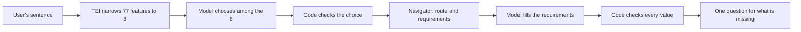

# How the assistant picks a feature

Built in #136, as [D-023](../decisions/0023-python-navigator-thin-bridge.md) point 5 planned it.
The whole agent around it is described in [the agent](agent.md).

## The problem

The user writes one sentence in Persian. The assistant must decide which of the profile's features
it means, or that it is a knowledge question, or that it cannot tell, and pull out the values it
gave. The model must not be able to invent a screen or an action.

## The steps

1. **Narrow** (`intent.FeatureIndex.closest`). Each feature's `title — ` Persian words (from
   `app_profiles/assistant_words.json`) is embedded once per process with the TEI embeddings and
   the model's `document` prompt. The sentence is embedded with the `query` prompt and compared by
   cosine, and the closest 8 are kept.
2. **Choose** (`intent.choose`). The model sees the sentence and only those 8 features, each with
   its intent, Persian title, Persian words and slot names, and answers `{"choice": ...}`, where
   `choice` is held by the schema to the 8 intents, `"knowledge_question"` or `"not_sure"`. Code
   turns anything else into `"not_sure"`.
3. **Route** (`agent_nodes.plan_for`). The navigator plans the chosen feature from the replica's
   current screen and lists every requirement on the route.
4. **Fill** (`slots.extract`). The model sees only the missing requirements (ref, type, Persian
   `ask` and `description`, and a choice's Persian labels) and the user's words, and answers one
   value or `null` per ref. Money is `{"value": whole number, "unit": "IRR" | "IRT"}`; a choice is
   one of its labels.
5. **Check** (`slots.checked`). Code drops a ref the plan does not ask for, uses an amount only if
   the user wrote it (`assistant/amounts.py`), and keeps a choice only as one of its allowed keys.
   What is still missing is asked in one question, using each `ask`.

The choice and the values are two calls, not one: the values the model is asked for are the
navigator's requirements for the chosen feature, which are only known after step 3.

`"knowledge_question"` gets a fixed message for now (no RAG yet). `"not_sure"` asks the user, with
the 8 closest features as choices by their Persian title.

## What the model never sees

The graph, the screens, the forms beyond the offered requirements, the field tags beyond the
offered slots, the user-only list, the lookups' records and any full card number (long numbers
are shown as `****` and their last 4 digits). Those are used by code only. The model cannot name a route or a tap, so it
has no way to reach a confirm.

## Measured

9 Nov 2026, Gemma 4 E4B-it on vLLM and jina-embeddings-v5-text-small-retrieval on TEI, with 20
Persian sentences over 18 features (transfers, a bill, a top-up, a card balance, a statement, a
loan, cheques, vehicles, notifications...) and 2 knowledge questions, run through `main_debug.py`'s
agent. The sentences are not committed: the frozen evaluation set is P6-02.

| Measure | Result |
|---|---|
| Right feature among the narrowed 8 | 18 of 18 (and both knowledge questions were answered as such: 20 of 20) |
| Rank of the right feature in the 8 | 1st for 11, 2nd for 1, 3rd for 4, 5th for 1, 8th for 1 |
| Model chose the right feature | 19 of 20 |
| Amount read exactly (toman to rials) | 6 of 6 sentences with an amount |

The miss: «قبض برقمو پرداخت کن» chose `wallet_bill` over `bill_payment`. Both are titled
«پرداخت قبض» in the app, so only their English descriptions tell them apart. The closest call:
«قسط وامم رو پرداخت کن» found `loan_repayment` 8th, because its title «تسهیلات در جریان و پرداخت»
has neither «قسط» nor «وام». More Persian words per feature, or sending all 77 to the model, are
the owner's choice if the evaluation set shows misses.

## How it will be tested

[The evaluation set](evaluation.md) (P6-02, #138) scores the choice and the values: 143 frozen
held-out cases and 43 tuning cases, run with `python tools/evaluate_agent.py`. A wrong `choice`
that code cannot catch is a critical wrong action when it prepares another feature with a form, so
the gate there applies here. The first run is in [the P6-02 baseline](../reports/p6-02-baseline.md):
the expected feature was among the narrowed 8 for 120 of 127 feature cases, and the model chose
the expected intent for 132 of 143. After the fixes of #140 (Persian words per feature, the
`document` prompt), it was among the 8 for 127 of 127 and every knowledge and not-sure case was
answered as such ([the P6-03 report](../reports/p6-03-fixes.md)).
