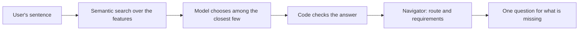

# How the assistant will pick a feature

A short design note for stage 6. Nothing here is built yet. The decision is
[D-023](../decisions/0023-python-navigator-thin-bridge.md), point 5.

## The problem

The user writes one sentence in Persian. The assistant must decide which of the profile's features
it means, or that it is a knowledge question, or that it cannot tell, and pull out the values it
gave. The model must not be able to invent a screen or an action.

## The steps



1. **Narrow.** Each feature's description is embedded once with the existing TEI embeddings. The
   sentence is embedded and compared, and the closest few are kept.
2. **Choose.** The model sees the sentence and only those few features, each with its intent, its
   description and its slot names. It answers in one fixed JSON shape:

   ```json
   { "choice": "card_transfer", "slots": { "card-transfer-destination": "رضا", "card-transfer-amount": "250000" } }
   ```

   `choice` is one of the offered intents, `"knowledge_question"` or `"not_sure"`.
3. **Check.** Code refuses a `choice` that was not offered and a slot the feature does not have, and
   checks money as an exact whole number. Anything refused becomes `"not_sure"`.
4. **Route.** `assistant/navigator.py` plans the feature. Code compares the requirements with the
   slots, and asks for what is missing in one question, using each `ask`.

`"knowledge_question"` goes to the RAG answer path. `"not_sure"` asks the user, with the closest
features as choices.

## What the model never sees

The graph, the forms, the field tags beyond the offered slots, and the user-only list. Those are
used by code only. The model cannot name a route or a tap, so it has no way to reach a confirm.

## How it will be tested

The frozen Persian evaluation set of P6-02 scores the choice and the slots. A wrong `choice` that
code cannot catch is a critical failure, so the gate there applies here.
