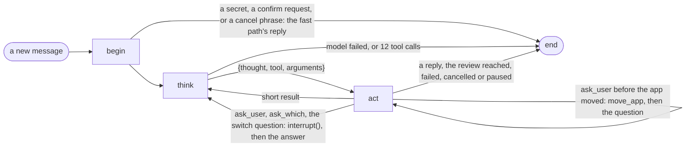

# The ReAct agent

The ReAct agent sits beside [the workflow agent](agent.md) and is chosen with
`ASSISTANT_AGENT=react`. The default is `workflow`. The decisions are
[D-032](../decisions/0032-react-agent-beside-the-workflow.md) and
[D-036](../decisions/0036-real-react-agent.md), which replaced
[D-033](../decisions/0033-react-uses-the-workflows-feature-choice.md)'s code-first understanding.

In the workflow, code decides every step, and the model fills JSON forms. In the ReAct agent, the
model reads every message in the conversation and decides the next step itself. On each step it
returns a thought and one tool call, sees the result, and this repeats. It replies to chat, finds
and starts a feature, asks which one is meant, sets the task's values, corrects a task at its
review, and cancels. Code keeps the safety fast path, every value check and every question shown
with options. Nothing can go past the review: only the user confirms.

## Run it

| Where | How |
|---|---|
| The backend (panel and graph page) | `set -a; source .env; set +a; ASSISTANT_AGENT=react python -m assistant` |
| One process, stand-in app | `python main_debug.py --agent react "۲۵۰ هزار تومان به رضا کارت به کارت کن" 1` |
| One process, the replica | `python main_debug.py --replica --agent react` |
| The evaluation | `python tools/evaluate_agent.py tests/evaluation/tuning.json --agent react` |

With `ASSISTANT_TRACE=1`, each step prints as `think` (the thought, the tool and its arguments)
and `act` (its result).

## The loop

One LangGraph `StateGraph` (`assistant/react_graph.py`):

- **`begin`** is door A of [D-034](../decisions/0034-conversation-flow.md). It starts each new
  message with an empty list of steps and puts it in the history (`turns`, the last 8 lines).
  - A typed secret (a PIN, password, CVV2 or code with its digits) is refused, and the history
    keeps «[حذف شد]» instead.
  - A typed confirm request is refused.
  - «لغو» or a whole-message cancel phrase cancels the open task, or says nothing is going on.

  None of these calls the model.
- **`think`** sends the model one prompt. It holds:
  - the rules;
  - the tools it may call now;
  - the conversation, masked;
  - the open task, if there is one: its feature and where it is (at its review, or paused), its
    messages, the fields the model may set (each one's Persian question and words, and a choice's
    labels, never its keys), the values held as masked labels, and what is missing;
  - this turn's steps, each as call → result.

  The model answers through `Chat.step`. Its schema has one `anyOf` branch per available tool, so
  the server holds the tool's name and the shape of its arguments. A tool without arguments has no
  `arguments` key, because a required empty object made the model pad the answer with whitespace
  until it ran out of tokens.
- **`act`** runs the tool in code and keeps a short JSON result with the step. If the task is at
  its review or paused, `set_values`, `move_app` and `open_review` open it again first.

The state is the workflow's `AgentState` plus `steps`. The chat box, the panel, `main_debug.py` and
the evaluator read both agents the same way.

## The tools

What is offered depends on the state:

| State | Tools |
|---|---|
| No task open | `reply`, `find_features`, `current_screen`; after `find_features`, also `start_task` and `ask_which` |
| A task open, something missing | the above, `cancel_task`, `find_records`, `set_values`, `move_app`, `ask_user` |
| A task open, nothing missing (also at its review, or paused) | the above, `cancel_task`, `find_records`, `set_values`, `open_review` |
| The app waits on a question's page | `current_screen`, `ask_user` |

| Tool | What code does |
|---|---|
| `reply(text)` | The model's own reply, through CF-3's `safe_chat`: it is masked, and a reply that holds a number, an amount or a claim that something was done is replaced with a fixed line. It ends the turn. While a task waits on a missing value, code asks the task's question right after the reply (RA-9: the model looped on replies). With no task open, the request counts as answered (`knowledge_question`). |
| `find_features(request)` | TEI's closest features: first those closest to the user's newest words (TEI ranks the user's own words best), then those closest to the model's request sentence (what «همونو» refers to). At most 8, each with its name, title and words, and `"named": true` when its title is in the user's words. The app's wallet features (`wallet_*`) are left out until the user has said «کیف» (RA-9), so a plain top-up or bill is never offered as the wallet's. Nothing is started. |
| `start_task(feature, request, second)` | Starts one of the features the newest `find_features` found: no other name is allowed. The request goes through CF-2's `standalone` and rewrite guard: the model's sentence is used only when the conversation has earlier words or a second task, and when every amount, number and name in it is the user's own; else the user's message. `second` is said again at the review. If another task is open, code asks «… لغو شود و … شروع شود؟» (yes, no, «لغو»). A page to see is opened at once. Otherwise the workflow's reader reads the request at once and the result lists what was kept, what is missing and the next step (RA-9: one model step fewer). |
| `ask_which(features)` | «منظورتان کدام است؟» with 2 to 4 found features and «لغو». A pick goes back to the model, and typed words are a new message for it. |
| `cancel_task()` | Cancels the open task. The app stays where it is. It is not offered for a task the model started after the user's last words. |
| `find_records(ref, words)` | Returns the records the app's picker lists for that field that match the words, as masked labels (at most 8). |
| `current_screen()` | Returns the page by its Persian name (Home, a feature's page or review) and the values given there. Never a screen ID. |
| `set_values(values)` | The workflow's own reader (`slots.extract`) decides every missing field, and what it finds nothing for is asked; the model's value counts only for a value held before (a correction). Then the workflow's `check` and `resolve` run. Returns every value the model named as it is now held, what was refused (and why), and what is missing. A held value the model sends back as the label it was shown is unchanged and not checked again (a masked label is not the user's words). At a correction, the reader has read the newest message as the task opened again, so the model's copy of a value does not overwrite it (RA-9). |
| `move_app()` | Runs the workflow's `advance`: the app goes as far as the values allow and waits on the page of the first missing value ([D-029](../decisions/0029-asked-on-the-screen.md)). |
| `open_review()` | Runs the workflow's `prepare`, `verify` and `ready_for_user`. The reply is the workflow's list of prepared values. An uncertain command is planned again once, with the workflow's `reconcile`. |
| `ask_user(question)` | It moves the app to the question's page first, so `move_app` is not needed before it. The question is the workflow's, after the model's reply if it gave one; the model's words are not used. It holds every missing question of the page the app waits on, with the records (2 to 8) or allowed choices as options, and «لغو». A picked option, or a typed answer naming one listed record, sets that value. A typed secret or confirm request is refused and the question asked again. Other words go back to the model, which decides: an answer, chat, another task or a cancel. |

There is no confirm, submit or pay tool. The app is reached only through `TaskRunner`, so the
only commands are `navigate`, `fill_form` and `show_review`.

## The rules the model gets (RA-9)

- What each kind of message is, and the tool for it. A request starting with «نه», «ولش» or «بیخیال»
  is a new task, and `cancel_task` is never used to start another task.
- A reference («همین», «همون», «عین همین», «دوباره», «یکی دیگه») copies the earlier request's
  amount, card, account, number and person into the new sentence, changing only what the newest
  message changes.
- How to choose a feature: where the money comes from, the kind of task the user names (`named`),
  and each feature's words. `ask_which` only for a real tie.
- With the task at its review, the old follow-up's distinction: asking for a task again, or for
  someone else, is a new task; only changing a value is a correction.

## Guards, in code, whatever the model says

- **The fast path** runs before the model at both doors. A secret never reaches the history or a
  prompt. Typed at a question (`ask_user`, `ask_which` or the switch question), a secret or a
  confirm request is refused at once and the same question asked again, without the model.
- **A task the model just started cannot be cancelled by it.** `cancel_task` is not offered for a
  task started after the user's last words. Seen live: the model started the new transfer, then
  cancelled it in the same turn.
- **Values** pass the workflow's own checks:
  - money only as the user wrote it;
  - a choice only as one of its allowed keys;
  - a record only as the app lists it;
  - amount limits, installments and saved plates as today.
- **A record must be the user's.** `set_values` refuses a record whose words are not in the user's
  messages, so the model cannot pick one it only read in `find_records`. A record of generic words
  only («حساب») names nothing and is asked. Only the user picks a record or a saved plate the user
  didn't name.
- **A rewritten request holds only the user's own words.** Its amounts, numbers and names must be
  in the user's messages, or the user's message is used instead.
- **A feature comes only from `find_features`,** and leaving an open task for another is asked first.
- **A reply is guarded:** no numbers, amounts or claims that something was done.
- **No word of the user is lost.** If the model calls `move_app`, `ask_user` or `open_review`
  before `set_values` has read the newest words, the workflow's reader reads them first. A
  correction at the review is read by the workflow's reader when the task opens again.
- **The app moves before a question.** If the model asks while the app has not moved, `act` runs
  `move_app` as a separate step first. When the answer resumes the question, the move is not
  sent again.
- **Nothing is shown in full.** The user's words are masked as in the workflow, and every tool
  result and every prompt goes through `steps.masked`. The model never sees a screen ID or an
  app key other than a feature's name.
- **The same call twice in a row is not run again**: the model is told so (`REPEATED`). The
  exceptions are `ask_user` and `ask_which`.
- **A turn has at most 12 tool calls,** counted from the user's last answer. Then the request fails
  with a plain message, and nothing more is sent. A task at its review or paused stays as it is.
- **A model error ends the request as `failed`.** A task at its review or paused stays as it is.

## The steps in the panel

The panel's history and the graph page's chat both carry `agent_steps`, built by
`panel_api.agent_steps`:

- **The ReAct agent:** each step's Persian thought, its tool, and the tool's result as one masked
  line, cut to 160 characters.
- **The workflow:** each node that ran for the request, with a short Persian description and the
  task state after it, read from the checkpointer's history.

Both lists grow while the turn runs. In the panel, «مراحل دستیار (n)» under the messages opens and
closes them; each step shows its thought, then `action → result` left to right. On the graph page
they sit under the chat box in a collapsed «مراحل دستیار» section. The contract leaves the
history's body open (`docs/bridge/panel.md`), so `contracts/` does not change.

## Status

| Step | Issue | What |
|---|---|---|
| RA-0 | #166 | This note and D-032 |
| RA-1 | #167 | The switch and the loop with `ask_user` and `finish` |
| RA-2 | #168 | The read tools |
| RA-3 | #169 | The act tools, to the review |
| RA-4 | #170 | The steps shown in the panel |
| RA-5 | #171 | Both agents evaluated side by side |
| RA-6 | #172 | Native tool calls (blocked) |
| RA-7 | #182 | The workflow's feature choice first (D-033) |
| RA-8 | #198 | The model handles the conversation with tools (D-036) |
| RA-9 | #200 | Tuned where RA-8 failed: the review rule, feature choice, fewer steps, corrections |
