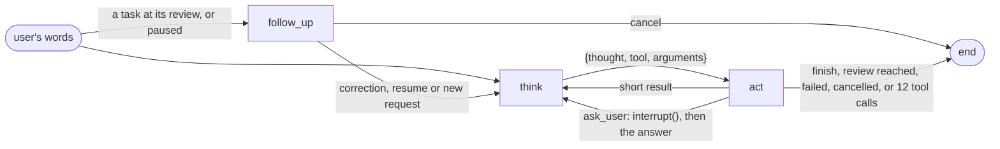

# The ReAct agent

The ReAct agent sits beside [the workflow agent](agent.md) and is chosen with
`ASSISTANT_AGENT=react`. The default is `workflow`. The decision is
[D-032](../decisions/0032-react-agent-beside-the-workflow.md).

In the workflow, code decides every step, and the model only fills three JSON forms. In the ReAct
agent, the model decides the next step itself. On each step it returns a thought and one tool
call, then sees the result, and this repeats. Every act still goes through the workflow's own
checks, and nothing can go past the review: only the user confirms.

## The loop

One LangGraph `StateGraph` (`assistant/react_graph.py`) with two nodes:

- **`think`** sends the model one prompt. The prompt holds the rules, the tools that can be used
  now, the user's messages (long numbers masked), the task so far (its feature, the values held
  as masked labels, and what is missing), and this turn's steps. The model answers
  `{"thought", "tool", "arguments"}` through `Chat.step`. The schema has one branch per available
  tool, so the tool name and the shape of its arguments are fixed by the server.
- **`act`** runs the tool in code and appends a short JSON result to the turn's steps.
- **`follow_up`** is the workflow's own `Lifecycle.follow_up`, used for a message after the review
  or while the task is paused.

The state is the workflow's `AgentState` plus the turn's `steps`. That way the chat box, the
panel, `main_debug.py` and the evaluator read both agents the same way.

## The tools

| Tool | Available | What code does |
|---|---|---|
| `find_features(text)` | always | Returns the 8 closest features by TEI: intent, Persian title and words. |
| `feature_requirements(intent)` | always | Plans the feature from the app's current screen (the workflow's `planned`). Returns each field's ref, type, Persian question, option labels (never keys), and what is held or missing. |
| `find_records(ref, words)` | with a task | Returns the records the app lists for that field that match the words, as masked labels. |
| `current_screen()` | always | Returns the screen's Persian title and its filled fields, masked. |
| `set_values(values)` | with a task | Runs the workflow's `check` and `resolve`. Returns what was kept, what was refused and why, and what is missing. |
| `move_app()` | with a task and something missing | Runs the workflow's `advance`: the app goes to the screen of the next missing value. |
| `open_review()` | with a task and nothing missing | Runs the workflow's `prepare`, `verify` and `ready_for_user`. |
| `ask_user(question)` | always | Calls `interrupt()`. While the task misses values, the question and options are code's (the workflow's), plus «لغو». Otherwise the model's question is used, with the last features found as options. |
| `finish(message)` | always | Ends the turn. Once a review is open, the reply is code's list of prepared values, not the model's text. |

There is no confirm, submit or pay tool. The app is reached only through `TaskRunner`, so the
only commands are `navigate`, `fill_form` and `show_review`.

## Guards

- Values pass the same code as the workflow's: money only as the user wrote it, choices only as
  allowed keys, records only as the app lists them, amount limits, saved plates. Nothing of the
  workflow is changed.
- A full card, account or IBAN number never reaches the model: the user's words are masked as in
  the workflow, and every tool result goes through `steps.masked`.
- A turn has at most 12 tool calls. After that, it ends with a plain message and does nothing more.
- A tool the state does not allow is not in the schema, and code refuses it anyway.
- A model error ends the task as `failed`, as in the workflow.

## Status

| Step | Issue | What |
|---|---|---|
| RA-0 | #166 | This note and D-032 |
| RA-1 | #167 | The switch and the loop with `ask_user` and `finish` |
| RA-2 | #168 | The read tools |
| RA-3 | #169 | The act tools, to the review |
| RA-4 | #170 | The steps shown in the panel |
| RA-5 | #171 | Both agents evaluated side by side |
| RA-6 | #172 | Native tool calls (blocked) |
