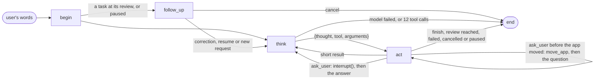

# The ReAct agent

The ReAct agent sits beside [the workflow agent](agent.md) and is chosen with
`ASSISTANT_AGENT=react`. The default is `workflow`. The decision is
[D-032](../decisions/0032-react-agent-beside-the-workflow.md).

In the workflow, code decides every step, and the model only fills three JSON forms. In the ReAct
agent, the model decides the next step itself. On each step it returns a thought and one tool
call, then sees the result, and this repeats. Every act still goes through the workflow's own
checks, and nothing can go past the review: only the user confirms.

## Run it

| Where | How |
|---|---|
| The backend (panel and graph page) | `set -a; source .env; set +a; ASSISTANT_AGENT=react python -m assistant` |
| One process, stand-in app | `python main_debug.py --agent react "۲۵۰ هزار تومان به رضا کارت به کارت کن" 1` |
| One process, the replica | `python main_debug.py --replica --agent react` |
| The evaluation | `python tools/evaluate_agent.py tests/evaluation/tuning.json --agent react` |

With `ASSISTANT_TRACE=1`, each step prints as `think` (the thought, the tool and its arguments)
and `act` (its result).

## The loop

One LangGraph `StateGraph` (`assistant/react_graph.py`):

- **`begin`** starts each new message with an empty list of steps.
- **`think`** sends the model one prompt. It holds:
  - the rules;
  - the tools that can be used now;
  - the user's messages, with long numbers masked;
  - the task so far: its feature, the values held as masked labels, and what is missing with
    each field's question;
  - this turn's steps, each as call → result.

  The model answers through `Chat.step`. Its schema has one `anyOf` branch per available tool, so
  the server holds the tool's name and the shape of its arguments. A tool without arguments has no
  `arguments` key, because a required empty object made the model pad the answer with whitespace
  until it ran out of tokens.
- **`act`** runs the tool in code and keeps a short JSON result with the step.
- **`follow_up`** runs for a message after the review or while the task is paused. It uses the
  workflow's own `Lifecycle.follow_up`: cancel, resume, correction or new request. A correction is
  read again by the workflow's reader (`slots.extract`), as in the workflow, and then settled.

The state is the workflow's `AgentState` plus `steps`. The chat box, the panel, `main_debug.py` and
the evaluator read both agents the same way.

## The tools

What is offered depends on the task's state:

| State | Tools |
|---|---|
| No task yet | `find_features`, `feature_requirements`, `current_screen`, `ask_user`, `finish` |
| A task with something missing | the read tools, `set_values`, `move_app`, `ask_user` |
| A task with nothing missing | the read tools, `set_values`, `open_review` |
| The app waits on a question's page | `current_screen`, `ask_user` |

The read tools are `find_features`, `feature_requirements`, `find_records` and `current_screen`.
`find_records` is offered only once a task has record fields.

| Tool | What code does |
|---|---|
| `find_features(text)` | Returns the 8 closest features by TEI: intent, Persian title and words. |
| `feature_requirements(intent)` | Plans the feature from the app's current screen, with the workflow's `planned`. Returns each field's ref, type, Persian question and words, and a choice's labels (never keys), plus what is held and missing. |
| `find_records(ref, words)` | Returns the records the app's picker lists for that field that match the words, as masked labels (at most 8). |
| `current_screen()` | Returns the page by its Persian name (Home, a feature's page or review) and the values given there. Never a screen ID. |
| `set_values(values)` | First reads any missing field the model left null with the workflow's own reader (`slots.extract`). Then runs the workflow's `check` and `resolve`. Returns what was kept, what was refused (and why), and what is missing. |
| `move_app()` | Runs the workflow's `advance`: the app goes as far as the values allow and waits on the page of the first missing value ([D-029](../decisions/0029-asked-on-the-screen.md)). |
| `open_review()` | Runs the workflow's `prepare`, `verify` and `ready_for_user`. The reply is the workflow's list of prepared values. An uncertain command is planned again once, with the workflow's `reconcile`. |
| `ask_user(question)` | With a task, the question is the workflow's and the model's words are not used. It holds every missing question of the page the app waits on, with the records (2 to 8) or allowed choices as options, and «لغو». A picked option, or a typed answer naming one listed record, sets that value; other words go back to the model. Without a task, the model's question is asked, with «لغو». |
| `finish(message)` | Ends a turn that has no task, with the model's message masked. |

There is no confirm, submit or pay tool. The app is reached only through `TaskRunner`, so the
only commands are `navigate`, `fill_form` and `show_review`.

## Guards, in code, whatever the model says

- **Values** pass the workflow's own checks:
  - money only as the user wrote it;
  - a choice only as one of its allowed keys;
  - a record only as the app lists it;
  - amount limits, installments and saved plates as today.
- **A record must be the user's.** `set_values` refuses a record whose words are not in the user's
  messages, so the model cannot pick one it only read in `find_records`. Only the user picks a
  record or a saved plate the user didn't name.
- **No word of the user is lost.** If the model calls `move_app`, `ask_user` or `open_review`
  before `set_values` has read the newest words, the workflow's reader reads them first.
- **The app moves before a question.** If the model asks while the app has not moved, `act` runs
  `move_app` as a separate step first. When the answer resumes the question, the move is not
  sent again.
- **A task ends only at its review, a cancel or a failure.** `finish` is offered only when there
  is no task.
- **Nothing is shown in full.** The user's words are masked as in the workflow, and every tool
  result and every prompt goes through `steps.masked`. The model never sees an app key or a
  screen ID.
- **A turn has at most 12 tool calls,** counted from the user's last answer. Then the task fails
  with a plain message and nothing more is sent.
- **A model error ends the task as `failed`,** as in the workflow.

## Status

| Step | Issue | What |
|---|---|---|
| RA-0 | #166 | This note and D-032 |
| RA-1 | #167 | The switch and the loop with `ask_user` and `finish` |
| RA-2 | #168 | The read tools |
| RA-3 | #169 | The act tools, to the review |
| RA-4 | #170 | The steps shown in the panel |
| RA-5 | #171 | Both agents evaluated side by side |
| RA-6 | #172 | Native tool calls (blocked) |
