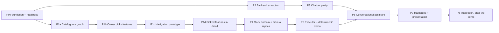

# Phase Specs

One file per phase, derived from the master plan (`docs/plan/RagBot_Assistant_Final_Project_Plan_v2.md`, §17).
These specs list the **planned tasks** for each phase in plain language. A task becomes a GitHub
issue labelled `proposal` when its inputs exist. Agents start it only after the owner approves it
(see `AGENTS.md`).

Specs for later phases stay at the task-list level on purpose. The plan says not to write
detailed instructions for screens before the APK has been examined (Appendix B).

| Phase | File |
|---|---|
| P0 Foundation | [P0-foundation.md](P0-foundation.md) |
| P1a-P1d APK investigation, feature choice, navigation prototype | [P1-apk-investigation.md](P1-apk-investigation.md) |
| P2 Backend extraction | [P2-backend-extraction.md](P2-backend-extraction.md) |
| P3 Chatbot parity | [P3-chatbot-parity.md](P3-chatbot-parity.md) |
| P4 Mock domain and manual replica | [P4-mock-domain-and-replica.md](P4-mock-domain-and-replica.md) |
| P5 Executor and deterministic demo | [P5-executor.md](P5-executor.md) |
| P6 Conversational assistant | [P6-conversational-assistant.md](P6-conversational-assistant.md) |
| P7 Demo hardening and review | [P7-hardening-and-demo.md](P7-hardening-and-demo.md) |
| P8 After-presentation integration | [P8-integration.md](P8-integration.md) |

## Dependency order

The order P1a to P1d follows owner decision D-019: catalogue the whole app first, then choose
features, then prototype, then go into detail.

**Revised by D-020 (owner, 29 Oct 2026):** the replica and the in-app bridge are now built
*before* feature selection, so the owner picks features by navigating a working replica; the
whole app's frontend is reconstructed at full fidelity from the start; and the Python routing
prototype (P1c) is dropped, its job done by the live replica plus bridge. The RagBot extraction
and parity work (P2/P3) runs in parallel. The authoritative ordering is
[`docs/plan/revised-build-sequence.md`](../plan/revised-build-sequence.md); the phase goals and
gates below are unchanged.
