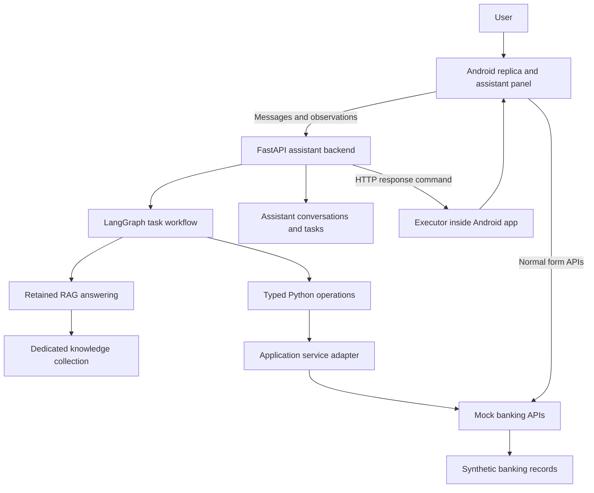

# RagBot Assistant — Final Project Plan

**Version:** 2.0  
**Date:** 27 October 2026  
**Repository:** [Hooman1996/RagBot-Assistant](https://github.com/Hooman1996/RagBot-Assistant)  
**Status:** Final planning baseline after review of plan v1 and the second manager’s review v3. Implementation must follow the phase gates below. This document does not claim that the APK has been analysed or that the system has been built.  
**Replaces:** `RagBot_Assistant_Project_Plan_v1.md` for future planning. Keep v1 and the review as historical records.

## 1. The project in simple terms

We are building an assistant for our banking application. It will answer the questions RagBot can answer, and also help a person use the application: find a feature, navigate to it, retrieve saved information through APIs, fill a form, explain missing information, accept corrections, and prepare a verified review.

For example, the user asks in Persian to prepare a transfer to رضا. The assistant finds matching saved recipients through a service. If there is more than one match, it asks the user to choose. It resolves the exact amount and source card, opens the transfer flow, fills the form, and checks the review. The user performs the final authorization.

The existing chatbot and the assistant are separate products. RagBot remains unchanged in its original repository. We extract the necessary backend capabilities into this new repository, give the assistant its own conversations and task records, and add application tools there.

The original APK is our reference for the mobile replica. REA helps the coding agents investigate it. We recreate the selected Android screens and workflows, using our own mock services and synthetic records. We do not need the bank’s original backend implementation or its hidden database tables.

An executor inside the replica performs navigation and form actions. The Python backend understands requests and manages tasks. The executor uses the application’s normal navigation and action handlers. Appium is used for external testing; it is not a requirement on users’ phones.

The first demonstration is deliberately small and complete: knowledge answers, a separate assistant entry, saved-recipient selection, and transfer preparation up to user review. We also produce an evidence pack showing what we understood from the APK, what we reproduced, and what remains unknown.

### The main decisions after review

| Area | Final decision |
|---|---|
| Runtime orchestration | LangGraph with typed Python functions and service adapters |
| Runtime MCP | Deferred; add a wrapper only when a real independent client needs it |
| REA | Keep its development MCP/CLI for APK investigation |
| Mobile communication | HTTP request/response action-result loop; one outstanding command per device |
| Mobile executor | Inside the app, using its chosen framework; Kotlin for native Android, a framework-native implementation if the APK uses another toolkit |
| Framework choice | Prefer the original toolkit after feasibility inspection; document any justified departure |
| LLM for application tasks | Structured intent and slot extraction, with bounded language assistance; deterministic execution and verification |
| LLM for knowledge answers | Retain the RAG answer-generation capability |
| Transfer draft | Owned by the mock banking service; UI and assistant use the same APIs |
| Persistence | A new project database with separate `assistant` and `mock_bank` schemas and roles; dedicated Qdrant collection |
| MinIO | Disabled unless a retained feature actually requires it |
| Delivery | One shared backlog, repository conventions, contracts and CI from the foundation phase |

The review decisions for every recommendation are in Appendix A. Changes to literal recommendations are explained there, including the parts rejected.

## 2. Business purpose, audience and success

The assistant reduces the effort of finding and preparing a banking task. A conventional chatbot explains where to go. This assistant can guide the application there and prepare the form while the user sees what is happening.

The demonstration audience is the application team and management. It should establish four things: the APK investigation was evidence-based; the selected replica behaves credibly; the assistant can reliably prepare a supported task; and the proposed bridge is a concrete integration the application team can evaluate later.

We will measure knowledge-answering parity, task-preparation success, clarification accuracy, navigation correctness, agreement between displayed and stored draft values, time to prepare a task, and verified reconstruction coverage. We will report results with scenario counts and versions. We will not present an unsupported whole-app accuracy percentage.

The longer-term goal is to help build assistants for other applications from app-specific evidence and integration contracts. V1 targets this banking app. General platform work waits until a second application gives us evidence about what should be shared.

## 3. Confirmed constraints and facts still to investigate

### Project constraints

The owner clarifications recorded in review v3 are adopted as project constraints:

- We own the application. Its current chatbot entry is Hibot, backed by RagBot.
- The APK is the source for reconstructing the mobile application. We will not request source code, documentation, test accounts or assistance from the application team before the surprise presentation.
- RagBot is read-only for this project. Do not modify its source, deployment, records, database objects, Qdrant collections or MinIO buckets.
- We create our own synthetic users and banking records. The mock services require no new authentication system.
- The assistant uses a model served on our own infrastructure. Cloud coding agents may inspect APK-derived material within the owner-authorized development scope; this does not make that material suitable for public redistribution.
- The initial demo runs on an Android emulator or compatible phone.
- The two managers maintain one agreed backlog. Codex and Claude Code implement its bounded tasks.
- The new repository is separate from RagBot. There is no merge-back workflow.

### Checks made for this planning revision

| Check | Finding | Practical meaning |
|---|---|---|
| New repository metadata and commit listing | `RagBot-Assistant` was public and empty when checked on 27 October 2026 | Keep sensitive evidence outside git; do not assume privacy or existing implementation |
| RagBot baseline | Read relevant files at `fc2f6a1dc85be71f782868f18833a895e502226a` | This is the extraction baseline, not a claim about the latest deployment |
| RagBot requirements lock | LangGraph is present; vLLM and the other serving/client dependencies are listed | Reuse the established orchestration approach; build a smaller lock for the extracted service |
| RagBot mobile API | Six mobile operations cover talk, history, feedback, comment, session close and satisfaction | These anchor the parity checklist |
| RagBot configuration example | Names `gemma-4-12B-it`, a vLLM endpoint, PostgreSQL and Qdrant | Example configuration does not prove the running model or hardware |
| RagBot startup/readiness | MinIO is optional in readiness, but the database-connection startup path constructs its client and attempts bucket operations | Extraction must explicitly remove that coupling when object storage is disabled |
| REA documentation | Provides Android investigation; Flutter inspection has important recovery limits | Detecting a framework does not establish that complete source or navigation can be recovered |
| APK itself | Not inspected in this planning pass | Framework, screens, contracts and fidelity remain investigation work |

The sources are listed in Appendix D. These checks are source inspection, not execution tests.

### Choices resolved by investigation rather than by guesswork

P0/P1 will determine the APK build, UI toolkit, original Hibot gateway path, accessible runtime screens, and the first workflow’s prerequisites. P2/P6 will identify the actual model, serving version, structured-output support and available GPU capacity. None of these unknowns requires reopening the overall architecture.

The default scope is transfer preparation. There is no promised delivery date until the APK feasibility and extraction checks establish the work involved. Repository visibility remains unchanged unless the owner separately changes it; the plan works with a public repository by keeping evidence private.

## 4. Scope and boundaries

### V1 must include

1. A standalone Python assistant backend with its own entry point, configuration, persistence and mobile APIs.
2. The retained mobile chatbot capabilities, with a recorded parity result for each feature.
3. An editable Android replica for the selected journey and its prerequisites.
4. Separate Chatbot and Assistant entries, assistant text interaction, minimize/reopen and cancel-task controls.
5. An in-app executor supporting observation, valid navigation, form preparation and verified results.
6. Stateful mock services for source cards, saved recipients, destinations, transfer drafts, validation and review.
7. A deterministic home-to-review demonstration before LLM-controlled actions.
8. Persian clarification and correction scenarios, including multiple people named رضا and ambiguous amounts.
9. Independent UI and backend checks, a reproducible runbook, and a measured fidelity/coverage report.
10. A private evidence pack and private code-findings register prepared for later owner-directed handoff.

### Deferred

Voice, runtime MCP, push channels, iOS, web/PWA reconstruction, a generic app marketplace/platform, and full-app implementation are later work. Whole-app inventory remains required, but detailed reconstruction proceeds feature by feature.

Real money movement and assistant-triggered final authorization are outside scope. A user can manually complete a simulated transaction against our mock service to demonstrate the handoff. That is recorded separately from successful assistant preparation.

A replica demonstration does not prove that we can control the unmodified original APK or deploy the bridge into its code. Original-app adoption requires the application team to implement and validate the integration after the presentation.

## 5. Relationship to RagBot and the extraction process

We retain useful backend code through a deliberate extraction. We do not clone everything and delete folders until it happens to start.

P2 traces imports, startup, database access, configuration, background tasks and external dependencies from the retained mobile answering path. It creates a new FastAPI entry point that imports only retained modules. Tests must prove that dashboard assets and evaluation packages are unnecessary at runtime.

The source manifest records the full RagBot SHA, each copied module, adaptations, licenses/attribution and dependency decisions. Use only dependencies that the new service actually needs. Do not copy a development environment freeze or machine-specific wheel paths into the new lock file. Check internal dependencies and package directories as well as individual files.

| Retain or adapt | Exclude from the runtime, with an explicit dependency check |
|---|---|
| Knowledge answers and contextual follow-ups | Web dashboard, templates, static files and frontend build tooling |
| Query rewriting, retrieval, embeddings and reranking | Evaluation application, knowledge-gap audit application and their routes |
| Required knowledge lookup and source attribution | Analytics dashboard and mass-answer/batch application |
| Mobile conversation/history/feedback functions | Web login, cookies, CSRF and dashboard roles |
| Necessary model/service/database clients | OCR and document-upload workflows unless a parity finding proves a requirement |
| Health, lifecycle, error handling and focused logs | Knowledge-base management UI/API; replace required development ingestion with a small offline utility |
| Relevant tests and Persian normalization functions | Production records, credentials and unrelated generated artifacts |

Removing the evaluation application does not remove testing. The new repository has focused model evaluation, contract tests and end-to-end acceptance tests.

### Mobile parity baseline

These are the source baseline’s operations. The assistant implements equivalent behavior in its own namespace; it need not reuse the same route prefix.

| Original operation | Behavior to preserve and test |
|---|---|
| `POST /api/mobile/v1/talk` | Answer, follow-up context, response fields, errors and session behavior |
| `GET /api/mobile/v1/history` | Correct user/session history, ordering and returned fields |
| `POST /api/mobile/v1/queries/{query_id}/feedback` | Feedback for an owned answer |
| `POST /api/mobile/v1/queries/{query_id}/comment` | Comment behavior and validation |
| `POST /api/mobile/v1/sessions/{session_id}/close` | Session closure and resulting lifecycle behavior |
| `POST /api/mobile/v1/sessions/{session_id}/satisfaction` | Satisfaction behavior and validation |

Also inspect citations, streaming, attachments, normalization and language behavior. Mark each as present and retained, absent, adapted, or deferred with a reason. Do not infer a capability from a route name alone.

The original talk request includes gateway-supplied identity context. The new demo uses synthetic context; it does not copy real national identifiers or treat an LLM-provided user ID as trusted identity.

The replica’s Chatbot entry uses an isolated compatibility path in the new environment that reproduces the observed legacy behavior and cannot navigate. Its sessions are separate from Assistant sessions. Both can reuse the extracted answering core. This lets us demonstrate both menus without making the demo depend on RagBot writes or its production availability. A direct connection to an existing development chatbot is an optional later integration, not the demo default.

Assistant questions are never forwarded through the original chatbot’s public session endpoint. Later RagBot fixes can be consciously ported with attribution and tests; nothing synchronizes automatically.

## 6. Architecture and responsibility

| Component | Responsibility |
|---|---|
| Android UI | Render the selected app screens and the two separate chat experiences |
| In-app executor | Observe state, validate commands, navigate, invoke normal handlers, verify UI results |
| FastAPI | Mobile conversation APIs, command-result processing, session/task access and health |
| LangGraph workflow | Persist task progress and choose the next permitted deterministic step |
| Local LLM | Intent/slot interpretation and language generation within the boundaries below |
| RAG module | Knowledge retrieval and grounded answers |
| Feature adapter | Translate stable application operations to mock HTTP services, later real services |
| Mock banking service | Own synthetic business records, drafts, validation and simulated user submissions |
| PostgreSQL | Assistant persistence and separately owned mock banking data |
| Qdrant and TEI | Retained vector retrieval, embeddings and reranking as needed by the extracted pipeline |
| MinIO | Optional objects only when justified by a retained feature |
| REA | Development investigation; outside the runtime |
| Appium | External UI checks and original/replica comparisons; outside the runtime |

Use a modular assistant service and one mock-service process initially. There is no need for a microservice per tool, a separate workflow engine, Redis, Kafka or a web dashboard for v1. PostgreSQL provides durable task and command records. Retain an existing dependency only when the import trace establishes its need.

### Why runtime MCP is deferred

The orchestrator and its Python operations are in our own service. Calling them through another local MCP process adds transport and lifecycle work without a current independent consumer. Typed operations and stable schemas provide the boundary we need now.

MCP remains appropriate for REA’s development tooling. A runtime MCP wrapper can be added around the same approved operations if another client later needs standard discovery and invocation. That wrapper must preserve command validation and the final-authorization boundary; it does not replace the mobile executor.

## 7. APK investigation and evidence

The APK can expose client request/response structures, resources, navigation declarations and sometimes device-local databases. It cannot establish the hidden server database or every service behind a gateway. Our mock schema recreates the data and behavior needed by the client.

### P1a: first workflow in detail

1. Preserve the APK and splits privately. Record SHA-256, package/version, signing digest, supported ABIs and Android requirements.
2. Pin the REA package and required tools. Follow that version’s Node/JDK/JADX requirements rather than assume every newer Node version is supported. Save a setup recipe for both coding-agent environments.
3. Identify the UI toolkit, packaging, navigation approach, resources and obfuscation limits. Confirm what REA can recover for this actual build. Flutter detection alone is not full Dart code recovery.
4. Fix the emulator profile: OS/API level, resolution, density, language, font scale, keyboard and relevant display settings.
5. Trace startup and the first complete journey: demo identity, home, chatbot menu, source selection, saved recipients, amount, review and the user-confirmation boundary.
6. Capture accessible original UI states and hierarchy; document loading, errors, dialogs, validation and Back behavior. If a screen cannot be reached, record why and its evidence limit.
7. Recover client contracts, units, identifiers, context and errors. Record original endpoint details privately and use our own development addresses in the replica.
8. Produce a feasibility finding, screen catalogue, navigation graph, contract map, unknowns ledger and first reconstruction specification.

### P1b: the rest of the application

Continue a broad inventory of every discoverable menu, feature, entry point and service dependency while P2–P5 progress. Catalogue completeness is relative to the pinned APK and accessible observations. Server-delivered or unreachable behavior stays unknown.

For each feature, record evidence status, implementation coverage, dependencies and whether it is in v1. P1b does not authorize building every discovered feature.

### Evidence labels

| Label | Meaning |
|---|---|
| Observed | Verified in the running original application |
| Recovered | Supported by a precise APK code/resource location |
| Inferred | A plausible interpretation requiring verification |
| Designed for mock | Behavior deliberately introduced in our development system |
| Unknown | Insufficient evidence |

A method, an activity declaration or a promising string does not prove a working navigation path. Each graph edge has evidence and a runtime verification status.

Each screen record includes its semantic name, original reference if recoverable, controls, inputs, required context, outgoing transitions, form rules, service dependencies, observed states and unknowns. Each edge records source/target, operation, prerequisites, arguments, expected outcome and recovery behavior.

### Evidence handling and findings

APKs, decompiled source, raw REA sessions, original screenshots, runtime traces and the code-findings register stay in a private location outside the repository. Public git contains our own implementation, synthetic fixtures and sanitized specifications. Do not copy packaged credentials, internal hosts, private data or entire decompiled functions into public files. Recovered names/field structures can inform the design; raw evidence remains private.

Original-app runtime observation is limited to the observer’s own or explicitly authorized account, without transactions or production mutation. Do not probe endpoints or bypass controls to obtain inaccessible screens. Captures containing personal/payment data remain private and are not delivered in the plan or presentation. Use sanitized text and synthetic replica screens for the demo.

Record code findings with evidence reference, severity, confidence, reproduction conditions and suggested remediation. Treat a static suspicion as unverified until supported. Prepare a private report for the owner to review; sending it to the application team is a later explicitly directed action.

A new APK version is a planned evidence/profile refresh. Do not silently replace the baseline halfway through acceptance testing.

## 8. Replica framework, fidelity and user experience

Prefer the original app’s UI toolkit and navigation structure when evidence and available tools support a maintainable reconstruction. If it uses native Views or Compose, implement a native executor, usually in Kotlin. If it uses Flutter, implement the UI executor in Dart; add a Kotlin platform channel only for a demonstrated native need. Other toolkits require the same framework-aware decision.

The toolkit choice is finalized after P1a. A departure needs a short decision record describing the evidence limitation, alternative, fidelity impact and later integration impact. Matching an unknown, obsolete or poorly recoverable implementation at any cost is not required. Matching the toolkit also does not guarantee the original team can adopt our source unchanged.

Use recovered screen names, strings, resource identifiers and API fields where useful and suitable for the intended repository. Keep stable semantic IDs for the assistant even if original IDs are obfuscated or unstable. Our replica has its own package identity and mock backend configuration, so it can coexist with the original and cannot accidentally become a production client.

### Fidelity is two separate results

For every selected screen, verify behavior: validation, buttons, Back, keyboard, dialogs, loading, errors, RTL and field presentation. Separately compare visual layout under the fixed emulator profile.

Use screenshot differences only for original states that we can observe under comparable conditions. Define comparison regions, masks, render settings and a reviewed tolerance before scoring. Mask unavoidable dynamic fields and personal data consistently; do not hide unexplained differences. Record the metric and threshold with the baseline. Screens without a reference are marked unscored, never assigned a passing similarity score.

The presentation report shows the number of discovered screens, scoped screens, comparable screens, behavior checks passed, visual results and remaining unknowns. Evidence images stay private; the public report uses sanitized descriptions and synthetic replica output. A single visual score cannot establish complete application equivalence.

### Chatbot and assistant UI

The chatbot menu has **Chatbot** and **Assistant** entries. Chatbot has no application tools. Assistant has the retained conversation features plus progress, clarification choices and task status.

- Open: show or resume the assistant conversation.
- Minimize/close panel: hide it and preserve state. Already authorized preparation may continue while the app is active; hiding never authorizes submission.
- Reopen: restore conversation, task status and any pending question.
- Cancel task: stop pending automated work, invalidate outstanding commands and report any effects already completed.
- Background/disconnection: pause automation and re-observe before resuming. Do not build a background-control service for v1.

Minimize and cancel are visibly different controls. A clarification or review remains paused for user input even when the panel is hidden. Manual navigation updates the observation and may invalidate an outstanding command. Logout or a synthetic-user switch invalidates the old task/device binding.

The mock environment can have a simple synthetic-user selector or mock version of a recovered login screen. It does not implement a new authentication scheme or ask for real banking credentials.

## 9. Navigation and the in-app executor

Android has no universal function that accepts any component ID and activates it anywhere. View IDs, navigation destinations, activities and framework semantics are different. We create a small bridge with semantic operations, mapped to the app’s real handlers.

The backend requests an allowed destination and supplies resolved task information. The in-app executor owns route planning/execution using the versioned graph and current state. Do not maintain a second competing route planner in the LLM/backend.

The agreed policy is:

1. Observe the current screen, form state, modal, loading state and task binding.
2. Use direct navigation when the destination is supported and its prerequisites are satisfied.
3. Otherwise choose a verified intermediate route and satisfy prerequisites with validated task information.
4. Ask for missing information through the backend when required; stop on an unknown or unsupported transition.
5. Verify each operation before continuing. Never skip validation simply because the target screen can be opened.

Manual UI controls and executor operations call the same application handlers. Both use the same draft APIs. The executor must not set hidden fields or mutate a separate copy of business state.

Start with a small operation set: observe state, navigate to a registered destination, populate a supported transfer form, select a returned candidate, and show the current review. Any low-level activation is restricted to explicitly registered actions. There is no arbitrary script, shell, deep-link, coordinate-click or unrestricted component-ID tool exposed to the assistant.

Profiles hold the sanitized screen map, graph, fields, allowed operations, prerequisite rules and expected outcomes. Banking-specific validation belongs in the banking adapter/domain module. The reusable workflow engine should not embed screen names throughout its code.

## 10. Contracts and the mobile command loop

`contracts/` is the source of truth for our public interfaces. Use versioned OpenAPI plus referenced schemas for mobile requests, commands, observations and results. Generate Python transport models and mobile DTOs where supported. Application handlers, authorization policy, domain objects and database models remain explicit implementation code.

Pin the generators, check generated files for drift and validate them against shared example payloads. The API implementation cannot silently introduce a field or status absent from the contract. Recovered original contracts and newly designed assistant contracts are identified separately.

### Proposed API groups

| Interface | Initial operations |
|---|---|
| Assistant mobile API | Send message, post command result/fresh observation, resume, cancel, history, feedback, comment, session closure, satisfaction |
| Isolated Chatbot compatibility API | Legacy conversation features without action tools or assistant session sharing |
| Mock banking API | Cards, recipients, destinations, create/update/read draft, validate/review, cancel draft, read simulated outcome |
| User-only mock application API | Simulate final submission and retrieve its receipt |
| Test harness | Reset fixtures and select fault scenarios; never an assistant tool |

Exact endpoint paths are finalized with the P0/P1 contract skeleton; the groups and responsibility boundaries are settled by this plan.

### HTTP loop

1. The app sends text or a resume/result request with current observation and synthetic user/device context.
2. The backend returns a message, clarification, terminal preparation status, or one command.
3. The executor validates and records that command before operating the UI.
4. It performs a bounded operation, verifies the outcome, persists its result, and posts that result with a fresh observation.
5. The backend reconciles the result with task and draft state, then returns the next response.

Only one command is outstanding per device. A bounded navigation operation can include several graph edges, but verifies each and returns a transition trace; long routes are split at safe checkpoints. If an unmet prerequisite needs user input, return a blocked result with the verified current state and required information. Do not report the destination as reached. A delivery acknowledgement is not a completion result.

There is no WebSocket, server push or background polling requirement in v1. On foreground/reconnect the client explicitly resumes with a fresh observation. Network request deadlines and command budgets are configured. If LLM inference cannot fit the mobile request budget after tuning, record evidence and add a small asynchronous HTTP status mechanism in a later contract revision rather than pretend the synchronous loop succeeded.

### Required fields

| Record | Important fields |
|---|---|
| Command | Protocol/profile version, task and task-revision IDs, command ID, device/session binding, operation, typed arguments, expected observation version, expected draft/review version where relevant, expiry |
| Observation | Observation version, app/profile version, recognized screen, modal/loading state, visible relevant field references/values, current draft and version, supported next operations |
| Result | Command ID, outcome, verified postcondition, fresh observation, resulting draft version, safe error code, transition trace if applicable |
| Conversation request | Request ID, conversation/session, user message or structured clarification selection, current context and observation |

Keep user/session context outside model-generated arguments. Use opaque references and masked display information where possible. Do not send full UI dumps or card numbers to the model by default.

### Retries, manual interaction and cancellation

Persist deduplication records at the backend and executor. Duplicate request/command IDs return the recorded result. A timeout does not prove that no action occurred: query/reconcile current UI, command journal and draft before retrying. No exactly-once execution guarantee is claimed across the device and service boundary.

The executor rejects expired, cancelled, mismatched-profile and stale-observation commands. Manual changes increment the observation version, and manual draft edits also increment the business draft version. Reconciliation starts from current state.

Cancellation increments the task revision and invalidates queued/outstanding commands. A late result can be retained for audit and state reconciliation but cannot advance the cancelled task. Already-applied draft edits are reported honestly; cancellation does not claim to undo them. A new task on the same device waits until the previous command is reconciled.

## 11. Local model, RAG and deterministic tools

The same locally served model infrastructure can support both answer generation and task interpretation, but the paths have different responsibilities.

For knowledge questions, retain the RAG pipeline and its banking scope, Persian language behavior, follow-ups and evidence rules. For application tasks, the model proposes a supported intent, extracted slots, corrections and missing/ambiguous information in constrained JSON. It may phrase a clarification or explanation from validated facts. It does not determine whether a financial value is valid or a task has succeeded.

Deterministic code owns candidate lookup, selection validation, ambiguity policy, currency/unit conversion, required-field checks, service calls, workflow state and outcome verification. The executor owns navigation. The user chooses between ambiguous recipients. The model may extract a name but cannot invent a recipient ID, trust a guessed source card or choose an amount because it seems likely.

Use vLLM’s schema-constrained output support only after a smoke test against the actual deployed version/model/parser. Validate the result again in application code and handle truncation, unsupported schemas and malformed output without executing an action. Valid JSON does not mean correct intent or correct values. Do not hard-code a deprecated serving parameter from an unrelated version.

The configured `gemma-4-12B-it` name is a baseline candidate, not a confirmed deployed model or a proven limitation. Benchmark the actual model before accepting it. If it fails the evaluation gate, improve the prompt/schema, narrow the supported request set with visible limits, or select an available stronger local model; rerun the gate.

### Persian normalization and clarification

Reuse useful RagBot orthography normalization after inspection. Add explicit tested handling for Persian/Arabic/Latin digits, separators, spoken numbers, mixed language, currency and تومان/ریال conversion. Existing orthography normalization preserves digit/identifier content; it is not already a complete monetary parser.

Keep original user wording and normalized values separately. Parse monetary values into exact integer units, never floating point. A colloquial expression such as «۱۰ تومن» requires exact-value clarification when its intended scale is ambiguous. Do not resolve that ambiguity by model confidence alone.

## 12. Data ownership and stateful mock services

Use one PostgreSQL installation if convenient, but create a new project database, for example `ragbot_assistant_dev`, with separate `assistant` and `mock_bank` schemas and roles. Neither role receives access to RagBot’s database. Migration/reset scripts verify their expected database/schema targets before changing anything.

The assistant service’s normal repository code stores conversations and tasks. The mock service’s repository code stores banking data. The model receives neither SQL tools nor database credentials. The assistant’s application adapter communicates with the mock service over HTTP; it cannot read `mock_bank` tables directly.

| Resource | Owner and use |
|---|---|
| `assistant` schema | Separate Chatbot/Assistant conversation namespaces, messages, feedback, tasks, slots, pending questions, command journal and verified outcomes |
| `mock_bank` schema | Synthetic users, accounts, cards, beneficiaries, destinations, transfer drafts and simulated transactions |
| Dedicated Qdrant collection | Knowledge for retained RAG; development fixtures or an independently approved export, never a reset of RagBot’s collection |
| Dedicated MinIO bucket, only if enabled | Objects needed by a retained feature; optional client is lazy and readiness depends on feature configuration |

Start knowledge parity with sanitized banking fixtures and retained regression cases. A private approved development knowledge export can be added later without publishing it. The demo must not require reading live RagBot records or mutating its knowledge resources.

### Mock records and rules

| Entity | Meaning |
|---|---|
| Synthetic user | The owner/context for all demo business records |
| Account/card | Source ownership, status, currency, balance and synthetic display details |
| Beneficiary | A saved person with a stable ID, name and aliases |
| Beneficiary destination | One of that person’s saved cards or accounts |
| Transfer draft | The authoritative source, destination, amount, fee/rule snapshot, version and review state |
| Simulated transaction | A user-triggered mock result, receipt and duplicate-submission reference |

This is our mock design, not recovered bank table names or relationships. A client response may combine data from many real backend sources that we cannot see.

The mock service owns the draft. Both manual edits and assistant-driven form handlers call the same update API. The assistant retains a draft reference, accepted version and resolved task intent; it does not maintain a competing authoritative transfer record.

Create/update calls use request IDs and expected draft versions. An effective change to source, recipient, amount, fee/limit inputs or expiry state invalidates the review and increments the relevant version. A no-op replay must not generate a new business change. Stale updates return a conflict that the client must reconcile.

Review validation returns the full display facts and current review/version token. The UI renders that returned state. If a fee or rule changes without a user edit, the previous review is invalid. Server-side draft state and visible state must agree before preparation is called ready.

The mock service has no new login, token or user-account authentication implementation. It accepts explicit synthetic development context on a controlled demo network. It still filters all data by that user and validates resource ownership. This separation is tested. The owner’s later gateway supplies trusted identity for real integration; no model argument chooses it.

Stateful fixtures cover one رضا, two different رضاس, multiple destinations, no matches, inactive sources, low balance, changed fees, expiry, service delays, errors and uncertain results. Fixture/reset controls are development-only and absent from model tools. The later service adapter may need mappings or workflow changes; we do not assume the real bank owns drafts in exactly our proposed way.

## 13. Final authorization and task lifecycle

The assistant is allowed to prepare, correct, validate and show a transfer review. It cannot authorize or submit it. This is enforced in the workflow, tool registry, operation schema and in-app executor allowlist, including any generic action path.

The user-only confirmation handler can call the mock submission endpoint. The assistant adapter has no submit operation. The app must not accept an executor command that dispatches the user-only handler, an alternative alias, a final-confirm deep link or a confirm-screen auto-submit side effect.

Reaching a review screen is allowed. Performing the authorization action is not. A rule banning every graph path to a screen containing a confirmation button would also prevent the required manual flow; the test must distinguish assistant operations from human UI events.

### Task transitions

State changes are persisted. The transition specification is used to generate coverage tests, with separate assertions for the intended behavior.

| Current state | Allowed next state(s) | Trigger/owner |
|---|---|---|
| `created` | `clarifying`, `resolving`, `paused`, `failed`, `cancelled` | Validated interpretation, unavailable interpretation service, interruption or user cancel |
| `clarifying` | `resolving`, `paused`, `failed`, `cancelled` | User answer, unrecoverable session/context failure, loss of active client or cancel |
| `resolving` | `clarifying`, `preparing`, `paused`, `failed`, `cancelling` | Deterministic lookup/validation or client/user event |
| `preparing` | `clarifying`, `verifying_review`, `paused`, `reconciling`, `failed`, `cancelling` | Verified executor result, missing input, interruption or cancel |
| `verifying_review` | `ready_for_user`, `preparing`, `clarifying`, `paused`, `reconciling`, `failed`, `cancelling` | Backend checks UI and authoritative draft |
| `ready_for_user` | `resolving`, `completed`, `cancelled`, `paused` | User correction; independently verified user submission; user cancel; interruption |
| `paused` | `resolving`, `reconciling`, `cancelled` | Explicit foreground/resume with fresh state, or cancel |
| `reconciling` | `resolving`, `verifying_review`, `ready_for_user`, `paused`, `failed`, `cancelled` | Current command/draft/UI state proves a safe continuation or stop |
| `cancelling` | `cancelled`, `reconciling` | Outstanding work is stopped or its uncertain effect must be checked |
| `failed`, `cancelled`, `completed` | None within the same task | A new user request creates a new task |

`ready_for_user` means preparation is complete; it is not evidence that money moved. A later `completed` outcome must name the verified user-only result. All unlisted transitions are rejected. An isolated knowledge answer does not create a transfer task.

### Command transitions

| Current state | Allowed next state(s) | Trigger/owner |
|---|---|---|
| `issued` | `executing`, `rejected_stale`, `rejected_expired`, `rejected_policy`, `cancelled`, `uncertain` | Executor checks; cancellation; delivery timeout |
| `executing` | `succeeded`, `blocked`, `failed`, `uncertain` | Executor verifies effect, encounters a missing prerequisite or reports an interruption |
| `uncertain` | `succeeded`, `failed`, `not_executed` | Reconciliation proves what occurred |
| A recorded terminal result | Same stored result on duplicate delivery | Deduplication; no replay |

Only verified postconditions make a command successful. Cancellation can stop between route steps; an already applied step is reconciled, not erased from the record. Task revision/observation checks apply before every side effect and after waits.

## 14. One complete example

1. The user opens Assistant and requests a transfer to رضا.
2. The app sends the message and fresh screen observation. The backend creates a task and interprets the request using constrained output.
3. Code searches saved recipients through the feature API. If there are two matches, the assistant presents safe choices; the user selects one returned reference.
4. The user supplies an exact amount and source. Missing or ambiguous details are resolved explicitly. An unrelated knowledge question can be answered without losing the task.
5. The backend asks the executor to reach the transfer flow. It uses valid direct navigation or verified intermediate steps.
6. The executor fills the form using normal handlers; those handlers update the mock service’s authoritative draft.
7. The service validates and returns the current review. The UI renders it and reports the draft/review version.
8. The backend compares recipient, source, amount, unit, fee and version against the task and service state. The assistant says the transfer is ready for the user’s review.
9. A correction invalidates the old review and repeats the necessary validation. Cancel stops automated work. Minimizing preserves the task.
10. If the user manually confirms in the mock app, the service creates one simulated transaction. The assistant reports a result only after independent outcome lookup. Otherwise the task remains ready for the user; no submission is implied.

## 15. Operations, configuration and isolation

Configuration covers model/server identity, TEI endpoints, project database/schema names, Qdrant collection, optional object storage, mock-service URLs, protocol/profile versions, request/command budgets and retention settings. Every setting has a documented default or startup requirement in the environment example. No secrets are committed.

The replica, mock services and assistant business-data adapter must never call production banking services. Use explicit development service addresses and a network allowlist/block test. Do not copy endpoint defaults from the APK. Original-app observation is a separate activity with its own limited scope.

The demo uses dedicated storage names and least-privilege service roles. The user-only mock submission API is separated from the assistant’s capability surface. Its absence from tools is reinforced by executor and workflow checks; a natural-language promise alone is insufficient.

Liveness reports whether the process is alive. Readiness checks configured required dependencies. When MinIO is disabled, neither its startup client nor its probe is required. When a feature enables it, readiness checks the resources that feature actually needs. Test the backend with MinIO completely unavailable.

Use structured logs with request, conversation, task and command correlation, safe error codes and latency. Avoid full card numbers, national identifiers, secrets and raw message bodies in routine logs. Record service/model failures, clarification counts, retries, stale-command rejections and successful preparation. Database records and private evidence have documented cleanup/export rules; development resets are scoped to this project.

Before using a GPU endpoint, identify the real model/server version, memory availability, inference concurrency and sharing arrangement. Prefer isolated demo capacity. Shared non-production inference is acceptable only after a bounded capacity check shows it will not impair RagBot; do not change RagBot’s serving deployment to make the demo work. Large model/evaluation runs must be planned around that capacity.

Prompts, retrieved passages, recipient names and UI text are data. They cannot add tools, change the authenticated/synthetic user, remove command checks or authorize an action. Tests include misleading instructions inside those data sources.

## 16. Repository and agent workflow

| Location | Purpose |
|---|---|
| `AGENTS.md`, `CLAUDE.md` | Shared implementation rules; one canonical body, mirrored and checked for drift |
| `assistant/` | FastAPI entry point, conversations, RAG integration, LangGraph tasks and command processing |
| `application_adapter/` | Typed feature interfaces, banking domain rules and mock/real HTTP adapters |
| `mock_services/` | Stateful mock APIs, fixtures, migrations and scenario controls |
| `android/` | Replica and in-app executor, with framework-specific source/build files |
| `contracts/` | Canonical OpenAPI/schemas, examples, generated transport models and compatibility versions |
| `app_profiles/` | Sanitized versioned destinations, screen/field maps, graph and permitted actions |
| `tests/` | Unit, service integration, contract, model-evaluation and device scenarios |
| `docs/` | This final plan, short overview, decisions, phase specs, source manifest and sanitized reports |
| `tools/` | Reproducible checks, contract generation, evidence indexing and safe demo reset commands |
| `deployment/` | Local development configuration and reproducible demo setup |

Private evidence has a separately configured root outside this tree. Code references evidence IDs, not a developer’s absolute private path. The APK itself and built APKs are not committed. CI can build a replica APK as a controlled build artifact; that is different from committing original or decompiled material.

### One shared backlog

Use GitHub issues in `RagBot-Assistant` as the default shared backlog. Because the repository is public, issues contain sanitized tasks and private evidence references only. Do not publish code findings or original endpoint details in issues, PR bodies or CI logs.

Both managers agree the active task order. An issue has one current implementation owner. Concurrent work may own separate folders after contracts are stable; agents do not receive conflicting instructions from separate managers. Contract changes require a reviewed PR and regenerated clients/tests. Routine implementation continues inside the approved task; only material scope or contract changes return to the managers.

Each task includes:

| Field | Required content |
|---|---|
| Goal | Observable behavior or concrete artifact |
| Inputs | Exact source/profile/contract revisions and prerequisite issues |
| Allowed changes | Files or directories the task may modify |
| Out of scope | Boundaries such as RagBot writes or production calls |
| Acceptance command | A reproducible command and expected outcome |
| Stop condition | Evidence that requires investigation instead of improvisation |
| Evidence | Commit, test result, known limits and relevant private evidence IDs |

The first eventual implementation commit establishes the conventions, source/evidence boundaries, plan, issue template and CI foundation. Work is reviewed on branches/PRs. This document-delivery task does not itself create commits, issues, PRs or remote settings changes.

Keep this document as the complete planning authority. The repository also has a short overview, small decision records and phase-specific task specs derived from it. Changes update the master plan or a clearly identified succeeding version; shortened agent documents must not silently become competing plans.

### CI grows with the components

The foundation runs conventions/contract checks, secret and forbidden-artifact checks, plus Python checks once source exists. P2 adds required Python lint, type and unit/integration jobs. P4 adds the selected Android toolkit’s build and device tests. P5 adds command/state-policy tests. P6/P7 add replayable evaluation and acceptance evidence.

An unimplemented component can be marked not yet applicable in P0, but cannot be reported as tested or satisfy its later gate. Once introduced, its checks are required. Do not add empty tests or permanently skipped jobs to create a green badge. Public CI uses synthetic fixtures and no production credentials; private original-app comparisons are recorded separately.

## 17. Implementation roadmap and phase gates

The phase order is settled below. Each issue is small enough to have explicit inputs, files, checks and stop conditions. Gates depend on evidence rather than arbitrary dates.

| Phase | Work | Gate and deliverable |
|---|---|---|
| P0 — Foundation | Repository conventions, final plan, shared backlog/template, CI foundation, private evidence setup, pinned source and APK acquisition/setup recipe | Foundation checks pass; original RagBot is untouched; source and input records exist; no forbidden material enters git |
| P1a — First-workflow investigation | Framework/REA feasibility, pinned emulator, detailed startup-to-review evidence, original Hibot contract path | First-workflow specification, evidence-linked graph, contract map and unknowns; toolkit decision; explicit observed/recovered/design boundaries |
| P1b — Whole-app catalogue | Broad inventory beyond the transfer slice; track inaccessible/server-driven features | Every discoverable feature classified against the pinned APK; implementation coverage and unknowns reported separately |
| P2 — Backend extraction | Import/startup trace, clean FastAPI entry point, minimal lock, isolated storage, optional MinIO | Backend starts without dashboard/evaluation imports or MinIO when disabled; retained regression tests pass; source manifest complete |
| P3 — Chatbot parity | Independent Assistant conversations and isolated Chatbot compatibility behavior, all discovered mobile features | Six mobile-operation behaviors tested; follow-ups and language cases tested; each exception documented and accepted by managers |
| P4 — Mock domain and manual replica | Canonical contracts, generators, new database/migrations, stateful services, manual Android journey | Home-to-review works manually with synthetic data; draft/version rules pass; scoped behavior/fidelity report; no production banking calls |
| P5 — Executor and deterministic demo | Observation/action/result loop, local route execution, stale/duplicate/cancel handling, policy gates | A non-LLM script completes home-to-review and alternate starts; visible UI and stored draft agree; final authorization is unreachable through assistant operations |
| P6 — Conversational assistant | Local-model smoke test, frozen Persian evaluation, typed extraction, clarification/correction, assistant controls | Model and full-task gates below pass; retained RAG parity holds; no fabricated success or implicit submission |
| P7 — Demo hardening and review | Fault scenarios, restart/resume, bounded load checks, clean install/reset/runbook, private findings/report preparation | Repeatable acceptance report and presentation; private evidence links; failures/unknowns honestly scoped; independent manager review |
| P8 — After-presentation integration | App-team evaluation, trusted gateway/service adapters, real bridge integration, staging tests | Same accepted scenarios run against the team’s implementation; compatibility differences resolved before any production claim |

P1a and P2 may proceed independently after their P0 inputs are ready. P1b can overlap subsequent phases and does not delay the first internal slice. P4 depends on the relevant P1a contracts/toolkit decision. P5 depends on a manually working slice. P6 action acceptance depends on P3 parity, P5 deterministic evidence and the model gate. A first internal demo can therefore happen at P5 without waiting for LLM integration or the whole-app catalogue.

P8 has no requirement for application-team cooperation before the surprise presentation. Production deployment, voice and expansion get separate scoped plans after the demo. Do not schedule a production rollout on the assumption that the replica’s source can simply replace the original.

### Stop conditions that matter

Stop the affected task when the APK/version is missing or changed, the recovered contract conflicts with the current specification, a necessary screen is inaccessible, toolkit recovery is materially incomplete, the clean extraction depends on an omitted module, a command cannot establish its effect, or any integration would require a RagBot/production change. Record the evidence and revise the task/assumption; unrelated work can continue.

These are task-specific dependencies, not reasons to leave the project unplanned or repeatedly ask the owner to choose routine implementation details.

## 18. Acceptance tests and quality targets

Evaluate four distinct things: retained chatbot behavior, replica fidelity, mock-service consistency and assistant task correctness. Testing only our own generated command/result fields is insufficient.

### Test layers

| Layer | Checks |
|---|---|
| Unit | Exact amount parsing, normalization, slot corrections, ownership filters, allowed task/command transitions and policy checks |
| Contract | Shared examples accepted by generated Python/mobile DTOs and HTTP implementations; invalid/unknown fields rejected appropriately; version compatibility |
| Service/database | Stateful drafts, optimistic concurrency, review invalidation, scoped reset, duplicate requests and user separation |
| Replica instrumentation | Compose/Views/Flutter integration tests according to P1; manual and executor paths invoke the same handlers |
| Independent UI | Selected Appium black-box scenarios inspect actual rendered controls/values rather than echo bridge reports; original comparisons when accessible |
| Model evaluation | Fixed Persian/mixed-language cases with expected intents, slots, missing/ambiguous fields and next outcome |
| Full system | Message-to-review scenarios plus corrections, interruptions, failures and fresh-state recovery |

Use framework-native device tests for routine replica CI. Keep Appium for the original and a focused independent replica smoke suite. No Appium server is needed in the end-user runtime.

### Initial acceptance targets

These are planning targets, not measured results. Record the frozen evaluation set and thresholds before P6 tuning. A later change needs a visible decision and a fresh reported run.

| Measure | V1 gate |
|---|---|
| Critical wrong action | Zero wrong recipient, source, amount/unit or assistant-authorized submission in the release scenario suite |
| Missing/ambiguous critical data | Every designated critical case clarifies or safely stops before a ready review |
| Structured output | Every response is either validated or handled without action; report first-pass valid-output rate separately |
| Persian interpretation | At least 95% exact intent plus critical-slot result on the unambiguous held-out extraction set; report per-field and ambiguity results |
| Complete task preparation | At least 95% successful preparation over the declared supported end-to-end acceptance runs, with zero critical wrong actions; failures must stop visibly |
| Deterministic controller | All release scenarios pass from their declared starting states, including interruption and stale-state cases |
| Mobile parity | Every retained mobile feature passes its contract/behavior checks; no undocumented feature loss |
| Visual fidelity | Per-screen reviewed tolerances pass for comparable scoped screens; blocked/unscored screens listed separately |
| Repeatability | Three clean fixture-reset runs of the demonstration succeed on the pinned emulator; test the selected phone separately if used |
| Performance | Record p50/p95 turn, lookup and command latency on the actual demo hardware; freeze a practical budget before P7 acceptance |

Build at least 100 held-out interpretation cases, including a clearly separated unambiguous subset large enough to report the 95% target meaningfully. Keep separate development examples for prompt tuning. Include multi-turn corrections and candidate selections, not just single sentences. Report numerators/denominators, repetitions and failures; small scenario sets do not prove population-level reliability. A structural/safety check must still hold even if extraction accuracy is imperfect.

### Required scenarios

| Scenario | Expected result |
|---|---|
| Knowledge answer and follow-up | RAG behavior retained; correct independent conversation context |
| Chatbot request | Answer only; no application tool/action path |
| Open, minimize, reopen | Conversation/task preserved; pending question restored; no implicit cancel or authorization |
| Direct navigation allowed | Reach and verify target with required context |
| Direct navigation lacks prerequisites | Traverse valid steps or ask for missing input |
| Unknown screen or modal | Re-observe and bounded recovery, or a clear stop |
| Two رضاس or multiple destinations | User chooses a returned stable reference before selection |
| «۱۰ تومن» or mixed digit forms | Exact scale/unit resolved; correct integer conversion |
| User supplies fields in different orders | Same correct draft; supplied details retained |
| User corrects source, recipient or amount | Latest version used; old review invalidated |
| Fee/limit changes after review | Fresh validation and review before ready status |
| Manual UI edit/navigation mid-command | Stale command rejected/reconciled; no overwrite from old state |
| Duplicate request/result | Recorded outcome; no repeated business effect |
| Lost response after a draft update | Read current state; no blind state-changing retry |
| Cancel with command outstanding | No further task advancement; completed effects reported accurately |
| App background, restart or reconnect | Pause; journal plus fresh observation before resumption |
| Service failure or malformed model output | Bounded failure/clarification; no invented success |
| Different synthetic user/session | No cross-user cards, recipients, history, task or draft access |
| Misleading instructions in retrieved/UI data | Data cannot alter operation permissions or identity |
| Final-confirm operation or alias | Rejected through every assistant path; manual mock path remains usable |
| Uncertain user mock submission | Authoritative status lookup; never automatic resubmission |
| Disabled MinIO | Backend starts and readiness reflects configured dependencies |
| Reset/migration | Only the dedicated project resources change |
| Development network boundary | Replica/mocks do not reach production bank hosts |

The acceptance report identifies source/release commits, APK hash, app profile/contract version, model/server identity, prompts, fixture version, emulator/phone settings, commands, run counts, failures and visual/behavior differences. Preparation success and manually simulated submission are separate results.

## 19. Demo and handoff package

The presentation proceeds through a small, repeatable story:

1. Explain the goal and show the separate Chatbot and Assistant entries.
2. Show the evidence/coverage report: what came from APK inspection and what was designed for mocks.
3. Ask a banking knowledge question and a contextual follow-up.
4. Request a transfer to رضا, resolve an ambiguity, and watch verified navigation/form preparation.
5. Correct an amount, show the new review, and demonstrate minimize/reopen and cancel.
6. Show that the assistant stops at user authorization. If needed, the presenter manually submits a clearly simulated transaction.
7. Explain the bridge/service adapter the application team would integrate and the remaining compatibility tests.

Deliver the replica build, backend/mocks setup, synthetic fixtures/reset instructions, model configuration record, contracts, profile, test results, sanitized fidelity report and known limitations. Keep APK evidence and code findings in the private handoff package. Do not include private code findings in public slides or repository issues.

The app-team handoff after the presentation includes a responsibility map: they supply trusted user context and actual feature services, implement/adapt the in-app executor, and test their native navigation/lifecycle. We provide the assistant APIs, typed operations, protocol, profile requirements and accepted scenarios. Neither the mock schema nor the reconstructed source is presented as their original backend/source.

## 20. Risks, limits and responses

| Risk or uncertainty | Planned response |
|---|---|
| Obfuscation, Flutter AOT or inaccessible original screens | Feasibility gate, private evidence, explicit unknowns and justified framework/scope decisions |
| APK does not expose hidden backend design | Recreate observable contracts and behavior; label mock design honestly |
| Replica differs from original | Separate behavior/visual checks; versioned comparisons and later team staging validation |
| Hidden RagBot startup dependencies | Import/lifecycle trace, clean service entry point, minimal lock and startup tests |
| Local model misinterprets Persian | Constrained extraction, deterministic critical checks, held-out evaluation and explicit clarification |
| Wrong or stale draft | One service owner, expected versions and comparison with the visible review |
| Timeout or cancellation races | Durable journals, one outstanding command, task revisions and reconciliation |
| Public repository leaks evidence | Private evidence root, sanitized task/specs, artifact/secret checks and PR review |
| Shared GPU harms existing service | Identify capacity before use; isolate demo inference or bound verified non-production sharing |
| App team uses a different integration model | Adapter/bridge contracts plus staging tests; no promise of drop-in adoption |
| Scope expands into a generic platform | First banking slice, whole-app inventory, later features as separate tasks |
| Timeline exceeds available capacity | Establish dates after P1a/P2; preserve the P5 deterministic internal demo |

## Appendix A. Decisions on every review recommendation

**Review assessed:** `plan-v1-review.md`, review version 3, dated 27 October 2026. There are 29 numbered recommendations across A, B, C, D and G. No complete recommendation is rejected; several are accepted with changes. The rejected clauses and reasons are explicit below.

| ID | Decision | Reason and resulting plan |
|---|---|---|
| A1 | Accept | P1 is both an engineering input and a showcase deliverable. APK-only evidence, graph and unknowns are central to credibility. See §§7, 17, 19. |
| A2 | Accept with clarification | Adopt private evidence, no production mutations, authorized observation and owner-authorized cloud-agent access. Public downloadability alone is not treated as redistribution permission; our stated ownership/authorization is the basis. No new authorization request is introduced for this owned app. See §§3, 7. |
| A3 | Accept with changes | Prefer the original toolkit/structure after inspection. Reject mandatory exact replication of all resource keys/obfuscated names and an unconditional Kotlin bridge: stable semantic IDs and a framework-native executor are more appropriate. Flutter support is limited and does not promise full recovery. See §§7–9. |
| A4 | Accept with changes | Add measured visual comparisons and behavior coverage. Reject an automatic score for inaccessible/non-comparable screens or a single number claiming complete fidelity. Use reviewed masks/tolerances and report scored coverage. The presentation report is sufficient; no new dashboard application is required. See §§8, 18. |
| A5 | Accept | Mock schemas reproduce the client’s required data/behavior, not the hidden bank database. This wording applies to tasks and presentation. See §§7, 12, 19. |
| A6 | Accept | P1a details the transfer slice first; P1b broadens the catalogue alongside implementation. This gets the first complete demo earlier without abandoning inventory. See §17. |
| A7 | Accept | Pin APK hash/version/profile and treat a later release as a separate refresh. Otherwise comparisons lose meaning. See §7. |
| A8 | Accept | Prepare a private evidence-backed findings register and owner-reviewed report. Handoff happens on explicit owner direction, not by automatically messaging the app team. See §§7, 19. |
| A9 | Accept | The repository is confirmed public. APKs, decompiled output, raw REA evidence, original captures and private findings stay outside git. No visibility change is needed to finish this plan. See §§7, 16. |
| B1 | Accept with changes | One shared issue backlog and bounded task template are adopted. Keep one canonical rule body with checked mirroring for `AGENTS.md`/`CLAUDE.md` rather than two drifting copies. Public issues contain sanitized evidence references. See §16 and Appendix B. |
| B2 | Accept with changes | CI begins with foundation checks and makes each component’s checks required when introduced. Reject pretending an Android build or application tests can pass before that component exists. Later phase gates cannot pass with placeholder jobs. See §16. |
| B3 | Accept with changes | One contract source generates transport models/DTOs and shared examples catch drift. Do not generate domain/database behavior or treat generated schemas as complete business validation. Generator support is verified for the selected toolkit. See §10. |
| B4 | Accept | Assign bounded folder ownership and review contract changes through one agreed backlog/PR process. This supports later concurrent work without contradictory instructions. See §16. |
| B5 | Accept with changes | Add a short overview, ADRs and phase specs for agents, while preserving this requested complete final plan as the master. Reject replacing the self-contained deliverable with disconnected short documents. See §16. |
| C1 | Accept | Reuse LangGraph and direct typed Python operations; runtime MCP adds no necessary independent boundary today. REA retains development MCP. A runtime wrapper is a later need-based extension. See §6. |
| C2 | Accept with changes | Narrow the action model’s role and benchmark it. Reject a literal global rule that the LLM can only classify/extract: the assistant must retain RAG answers and useful dialogue. Lookup, ambiguity policy, validation and outcomes remain deterministic; model size alone does not establish measured quality. See §11. |
| C3 | Accept with changes | Use the HTTP action/result loop, with one outstanding command rather than unverified command batches. Fresh observation and durable deduplication remain necessary after reconnect/timeouts. See §10. |
| C4 | Accept with clarification | The mock banking service owns drafts, with one update/validation path and review versions. Reject claiming we know the real bank has the same draft owner; later adapters may need mapping. Idempotent no-op retries do not create new versions. See §12. |
| C5 | Accept | Default MinIO off; lazy/conditional clients and readiness. Source inspection shows startup bucket work, so this is a P2 requirement rather than a vague future optimization. See §§5, 12, 15. |
| C6 | Accept | Specify task/command transition tables, allowed actors and tests, with explicit uncertain/cancellation handling. Tests also assert business outcomes rather than merely mirror tables. See §13. |
| C7 | Accept with changes | One PostgreSQL instance is sufficient, using a new project database and separate schemas/roles. Reject any arrangement allowing assistant/mock migrations or resets to touch RagBot’s database. See §12. |
| C8 | Accept | Use toolkit-native instrumentation/integration tests in replica CI, Appium for original-app observation and selected independent replica checks. Appium stays outside end-user runtime. See §18. |
| D0 | Accept | The verified mobile operations anchor parity; inspect the APK’s Hibot path and classify excluded web/OCR/batch/management surfaces. The replica’s isolated legacy path avoids a new dependency on RagBot writes. See §5. |
| D1 | Accept with changes | Add a fixed Persian/mixed-language evaluation set and reuse useful normalization. Reject assuming the existing orthography utility already parses amounts/units; that requires explicit tested code. See §§11, 18. |
| D2 | Accept | A deterministic complete slice is the first internal demo, before language-driven control. This isolates controller failures from model failures. See §§17–18. |
| D3 | Accept with stronger timing | Capacity/model/server checks happen before any shared inference or load evaluation, not after integration. Avoid disrupting RagBot and do not infer current hardware from a source document. See §15. |
| G1 | Accept with changes | Keep UI/profile knowledge as versioned data and banking logic in the adapter/domain module. Do not force executable banking rules into data files or build a universal plugin system for one app. See §§9, 16. |
| G2 | Accept | Deliver this banking assistant first; extract wider abstractions after a second application demonstrates the common requirements. See §§2, 4. |
| G3 | Accept as a later project boundary | For later third-party targets, establish owner authorization/appropriate scope before using the analysis workflow, consistent with REA’s stated scope. No extra approval loop is introduced for the currently owned app. See Appendix D. |

### Other review statements that needed precision

- **E10, final confirmation:** accept the objective, but test that assistant operations cannot invoke authorization. The human navigation graph can still reach the review and confirmation UI; otherwise the required app would be unusable.
- **REA setup:** the current README has specific supported Node ranges and tool requirements. “Node 22 or newer” is too broad. Pin a compatible version during setup.
- **REA and Flutter:** the documentation describes snapshot/library/build inspection and explicitly limits semantic class/function recovery. Treat toolkit identification and full workflow recovery as separate achievements.
- **Actual model/GPU:** an example model string, lock file or staging note is evidence of configuration, not proof of today’s serving deployment or performance.
- **MinIO startup:** readiness optionality does not establish startup independence. The source startup path performs MinIO work, which the extraction must separate and test.
- **Database recovery:** client contracts and local tables do not prove the hidden server database. This correction remains visible throughout the final plan.

### Answers to the review’s remaining questions

| Review question | Final planning resolution |
|---|---|
| Framework known? | Investigate in P1a; prefer the original after feasibility assessment. No guess is required now. |
| Hibot direct or gateway path? | Trace it from APK evidence in P1a; anchor backend parity to the pinned RagBot source in the meantime. |
| Actual model/shared GPU? | Identify and test before P6 model acceptance, and before using shared capacity. Local serving is fixed; exact deployment is not assumed. |
| Public or private repository? | Plan for its confirmed current public state; keep private evidence separate. Changing visibility is not part of this document task. |
| Deadline/extra screens? | Default first scope is transfer preparation and prerequisites. Dates and additions follow P1a/P2 evidence or later owner direction. |
| Shared GitHub issue backlog? | Adopted as the default manager workflow; no issues are created by this planning deliverable. |
| First implementation commit? | Its contents and branch/PR procedure are defined in §§16–17 and Appendix B. It belongs to the subsequent implementation task. |

The review’s answers in section E are otherwise reflected in the matching plan sections and phase gates. No unresolved review question prevents this final baseline from being used for P0.

## Appendix B. Initial P0 work packages

These are ready-to-file task definitions, not issues already created. The listed check commands are interfaces to implement in P0; they are not claims that these scripts currently exist or were run during planning. Use a cross-platform Python check runner so Codex/Claude workflows can run on Windows or Linux.

### P0-01 — Conventions, backlog template and CI foundation

**Goal:** Establish one implementation rule set and a reproducible foundation check.  
**Inputs:** This v2 plan, review decisions, empty repository.  
**Allowed files:** `AGENTS.md`, `CLAUDE.md`, `.gitignore`, `.github/`, `tools/project_checks.py`, foundation tests and minimal project metadata.  
**Acceptance command:** `python tools/project_checks.py foundation`  
**Expected:** Mirrored rules match; task template has required fields; CI runs actual checks; forbidden original APK/decompiled/secret fixtures are rejected.  
**Stop condition:** Any instruction would modify RagBot, require production credentials or publish private evidence.

### P0-02 — Planning and source baseline

**Goal:** Store the final plan, concise overview, decision index and extraction-source manifest.  
**Inputs:** Full RagBot SHA `fc2f6a1dc85be71f782868f18833a895e502226a`; read-only source access; this plan.  
**Allowed files:** `docs/`, `tools/project_checks.py`, baseline-check tests.  
**Acceptance command:** `python tools/project_checks.py baseline`  
**Expected:** Exact SHA/source references recorded; exclusions and evidence labels present; no production records copied.  
**Stop condition:** Source revision is unavailable or a conflicting baseline is proposed without a recorded decision.

### P0-03 — Private evidence root and APK identity

**Goal:** Resolve the original APK/splits and record a reproducible baseline before decompilation.  
**Inputs:** Owner-supplied or owner-designated official APK; private evidence root configured locally.  
**Allowed files:** Sanitized baseline/index in `docs/`, tooling/tests; actual APK and identifying evidence outside git.  
**Acceptance command:** `python tools/project_checks.py apk-baseline`  
**Expected:** The checker resolves the configured private input, computes/verifies hashes and records package/version/splits; no APK bytes enter repository output.  
**Stop condition:** Missing input, incomplete split set, hash mismatch or accidental production/private data exposure.

### P0-04 — REA environment and framework feasibility

**Goal:** Install/pin a compatible REA/toolchain recipe and identify the APK’s toolkit/recovery limits. This is the first decompilation/investigation work.  
**Inputs:** P0-03 baseline; current upstream requirements, then pinned tool versions.  
**Allowed files:** Sanitized setup/feasibility notes in `docs/`, tooling/tests; analysis output in the private root.  
**Acceptance command:** `python tools/project_checks.py rea-environment`  
**Expected:** Tool versions and a small APK query succeed; evidence IDs support the toolkit finding; limits are recorded.  
**Stop condition:** Unsupported host/toolchain or recovery limitations that invalidate the proposed replica approach. Escalate the specific limitation, not a guessed replacement architecture.

### P0-05 — Contract and lifecycle skeleton

**Goal:** Encode the settled mobile command/result structure, initial feature operations and transition rules.  
**Inputs:** §§9–13; P1a findings refine original-service field mappings later.  
**Allowed files:** `contracts/`, relevant `app_profiles/` skeleton, contract/state tests and check runner.  
**Acceptance command:** `python tools/project_checks.py contracts`  
**Expected:** Schemas/examples validate; no assistant submit/authorize operation exists; required versions/context fields are present.  
**Stop condition:** A required operation crosses the user-only boundary or conflicts with recovered app behavior. Preserve that conflict for a manager decision.

### P0-06 — Environment and resource isolation

**Goal:** Define project-only database/collection names and a demo environment that cannot call production banking services.  
**Inputs:** Available local infrastructure; §15; MinIO disabled by default.  
**Allowed files:** `deployment/`, environment examples, tools/tests and setup notes.  
**Acceptance command:** `python tools/project_checks.py isolation`  
**Expected:** Targets are dedicated, roles/names are separate, reset guard checks reject RagBot targets, and development host rules reject production endpoints.  
**Stop condition:** A resource can only be supplied by modifying RagBot or using production data. Continue other work with isolated fixtures instead.

After these tasks, create P1a/P2 issues using the same format and their actual file/import findings. Do not write speculative implementation instructions for every future screen before examining the APK.

## Appendix C. Plain-language glossary

| Term | Meaning |
|---|---|
| APK | Packaged Android application used as the reference |
| REA | Investigation tools used by coding agents to understand supported packaged artifacts |
| Replica | Our editable implementation of the selected app screens and behavior |
| Evidence pack | Findings plus references showing what was observed, recovered or still uncertain |
| API contract | Agreed requests, responses, errors and field meanings |
| Mock service | Our development API using synthetic records |
| Adapter | Translation between a stable assistant operation and a particular service |
| In-app executor/bridge | Code inside the app that performs permitted UI actions and reports results |
| App profile | Versioned app-specific screens, routes, fields and permitted operations |
| Observation | A versioned report of current relevant UI state |
| Draft/review version | Marker identifying the exact transfer details that were validated and shown |
| Idempotency | A repeated request does not create a second unintended effect |
| LangGraph | Workflow framework organizing conversation/task state and controlled steps |
| RAG | Generating answers using retrieved knowledge |
| MCP | Standard tool interface; used for REA now and optional for runtime tools later |
| Phase gate | Evidence required before dependent work is accepted |

## Appendix D. Sources and evidence for this revision

The two planning inputs were read in full: `RagBot_Assistant_Project_Plan_v1.md` and `plan-v1-review.md` (review v3). Prior conversation decisions are incorporated above. No original APK analysis or live deployment audit is claimed.

Source inspection on 27 October 2026 used:

- [RagBot extraction baseline](https://github.com/Hooman1996/RagBot/tree/fc2f6a1dc85be71f782868f18833a895e502226a).
- [Pinned mobile API](https://github.com/Hooman1996/RagBot/blob/fc2f6a1dc85be71f782868f18833a895e502226a/mobile_api.py), for the six parity operations and gateway context.
- [Pinned application entry point](https://github.com/Hooman1996/RagBot/blob/fc2f6a1dc85be71f782868f18833a895e502226a/main.py), for mixed web/mobile startup dependencies.
- [Pinned dependency lock](https://github.com/Hooman1996/RagBot/blob/fc2f6a1dc85be71f782868f18833a895e502226a/requirements.lock.txt), for framework/serving dependency presence; this is not the new project’s lock.
- [Pinned configuration example](https://github.com/Hooman1996/RagBot/blob/fc2f6a1dc85be71f782868f18833a895e502226a/env.example), for example model and storage configuration.
- [Pinned health checks](https://github.com/Hooman1996/RagBot/blob/fc2f6a1dc85be71f782868f18833a895e502226a/utils/health_checks.py) and [database connection startup](https://github.com/Hooman1996/RagBot/blob/fc2f6a1dc85be71f782868f18833a895e502226a/new_architecture/app/services/db_connection/connection.py), for optional-readiness versus MinIO startup coupling.
- [Pinned Persian normalization](https://github.com/Hooman1996/RagBot/blob/fc2f6a1dc85be71f782868f18833a895e502226a/utils/persian_normalization.py), for useful orthography behavior and its limits.
- [New repository metadata](https://api.github.com/repos/Hooman1996/RagBot-Assistant) and [commit listing](https://api.github.com/repos/Hooman1996/RagBot-Assistant/commits?per_page=1), for public visibility and the empty repository at review time.
- [REA README](https://github.com/morluto/rea/blob/main/README.md) and [Flutter analysis guide](https://github.com/morluto/rea/blob/main/docs/flutter-analysis.md), for tool requirements, target scope and reconstruction limits. Pin the actual chosen release during P0.
- [vLLM structured-output documentation](https://docs.vllm.ai/en/latest/features/structured_outputs/), for schema-constrained generation. Match the implementation to the pinned deployed version and verify it; current documentation does not establish support in our actual serving environment.

This v2 plan is the final planning baseline. The next project activity is the bounded P0 foundation work, followed by evidence-led P1a and read-only-source P2 extraction. Implementation and test results must be recorded as they happen rather than inferred from this plan.

